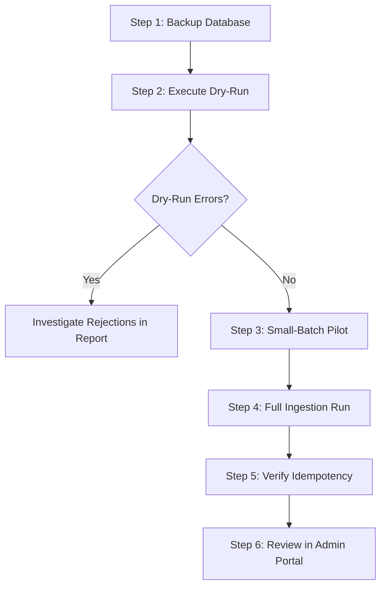
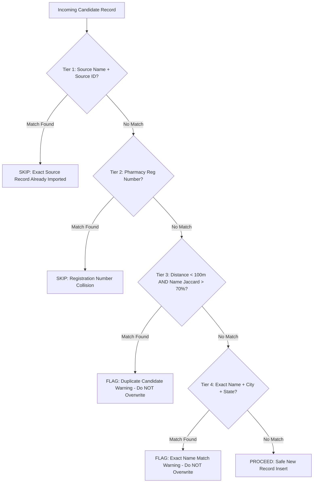

# MEDIFIND — DATA INGESTION OPERATIONS GUIDE

**Document Version:** 1.0.0  
**Effective Date:** November 17, 2026  
**Audience:** System Administrators, Data Engineers, DevOps Specialists, MediFind Platform Operators  
**System Component:** `pharmacies/pipeline/` & `pharmacies/management/commands/import_india_data.py`  

---

## 1. Overview & Operational Principles

The MediFind Data Ingestion Pipeline is an enterprise-grade, idempotent ETL (Extract, Transform, Load) system designed to ingest, normalize, validate, and deduplicate real healthcare facility location data across India into the MediFind PostgreSQL/SQLite database.

### Core Operational Invariants
1. **Never Overwrite Demo Stores**: Demo pharmacies (`is_demo=True`) associated with sample inventory and test user accounts are permanently preserved and protected from overwrite.
2. **Never Auto-Approve Imported Records**: All imported providers are flagged as `is_approved=False`. Only official administrator vetting grants `is_approved=True`.
3. **Idempotent Execution**: Ingesting the same dataset multiple times produces zero duplicate rows and zero unintended state mutations.
4. **Coordinate Integrity**: Facilities outside sovereign Indian WGS84 territorial bounds ($[6.5^\circ\text{N}, 37.5^\circ\text{N}]$, $[68.0^\circ\text{E}, 97.5^\circ\text{E}]$) or at (0.0, 0.0) are strictly rejected. Transposed (lng, lat) pairs are automatically detected and swapped.
5. **Atomic Transactions**: Batch imports execute inside database transactions (`transaction.atomic`). Unhandled batch errors trigger an automatic rollback without partial corruption.

---

## 2. Directory Structure & File Map

```
medfind_project/
├── data/                                      # Curated production data feeds
│   ├── national_hospital_directory.csv        # Public tertiary hospitals (NIN identifiers)
│   ├── osm_pharmacies_india.json              # Genuine retail pharmacies (OSM node IDs)
│   ├── abdm_health_facilities.json            # ABDM HFR healthcare facilities
│   └── test_edge_cases.csv                    # Regression test dataset with malformed records
├── pharmacies/
│   ├── management/commands/
│   │   └── import_india_data.py               # Production CLI orchestration command
│   └── pipeline/
│       ├── __init__.py                        # Unified exports
│       ├── normalization.py                   # 36 States/UTs canonical mapping, pincodes, phones
│       ├── validation.py                      # WGS84 boundary validation & schema verification
│       ├── deduplication.py                   # 4-tier deduplication engine
│       ├── adapters.py                        # Ingestion adapters for data.gov.in, OSM, ABDM
│       └── engine.py                          # Atomic batch execution engine
└── docs/
    ├── INDIA_WIDE_DATA_INGESTION_REPORT.md    # Executive summary of Stage 4 ingestion
    ├── HOSPITAL_DATA_IMPORT_REPORT.md         # Detailed hospital ingestion metrics
    ├── PHARMACY_DATA_IMPORT_REPORT.md         # Detailed pharmacy ingestion metrics
    ├── DATA_QUALITY_AND_DUPLICATE_REPORT.md   # Data quality, deduplication, and anomaly audit
    ├── DATA_SOURCE_AND_LICENSING_REPORT.md    # Legal, copyright, ODbL, and attribution audit
    └── DATA_INGESTION_OPERATIONS_GUIDE.md     # This operational manual
```

---

## 3. CLI Command Reference: `import_india_data`

The primary interface for executing data ingestion is the Django management command `import_india_data`.

### Command Syntax

```bash
python manage.py import_india_data [OPTIONS]
```

### Options & Parameter Flags

| Option Flag | Type | Default | Description |
| :--- | :--- | :--- | :--- |
| `--source` | String | `all` | Source feed selector: `all`, `hospitals`, `pharmacies`, `abdm`, `data_gov_in`, `osm`. |
| `--file` | File Path | Auto-detected | Custom CSV or JSON file path to ingest. Overrides defaults. |
| `--dry-run` | Flag | `False` | Simulates the ingestion, checks validation, runs duplicate detection, but performs **NO database writes**. |
| `--batch-size` | Integer | `50` | Number of provider records committed per atomic database transaction. |
| `--state` | String | None | Filters imported records strictly to a specified state name (e.g., `"Karnataka"`, `"Delhi"`). |
| `--limit` | Integer | None | Maximum number of records to ingest across the selected source. Useful for pilot runs. |

---

## 4. Standard Operational Procedures (SOP)

### SOP 4.1: Routine Full Data Sync Workflow

Follow these steps when running scheduled or routine data refreshes:



#### Step 1: Pre-Flight Database Backup
Always capture an SQLite / PostgreSQL snapshot before performing bulk updates:
```bash
# SQLite backup (Windows PowerShell)
Copy-Item db.sqlite3 -Destination "backups/db_backup_$(Get-Date -Format 'yyyyMMdd_HHmmss').sqlite3"

# PostgreSQL production backup (when running against managed cloud DB)
pg_dump -U medfind_user -d medfind_prod -F c -f "backups/db_backup_$(Get-Date -Format 'yyyyMMdd_HHmmss').dump"
```

#### Step 2: Execute Dry-Run Preview
Execute the command in dry-run mode to inspect record quality, check coordinate validity, and detect potential duplicate conflicts:
```bash
python manage.py import_india_data --source all --dry-run
```
*Expected Output:* Detailed table with planned imports, coordinate checks, duplicate warnings, and the explicit banner: `[DRY RUN COMPLETE] Zero database modifications performed.`

#### Step 3: Small-Batch Pilot Execution
Test real database integration on a controlled subset (e.g., 5 records per source):
```bash
python manage.py import_india_data --source hospitals --limit 5
python manage.py import_india_data --source pharmacies --limit 5
```

#### Step 4: Full Ingestion Run
Ingest all verified curated feeds across India:
```bash
python manage.py import_india_data --source all --batch-size 50
```

#### Step 5: Verify Idempotency
Immediately re-run the exact same command. Confirm that 100% of records are recognized as existing and skipped:
```bash
python manage.py import_india_data --source all
```
*Verification Assertion:* `Skipped (Already in DB): 89+`, `Imported: 0`.

#### Step 6: Review in Administrative Portal
1. Navigate to `http://127.0.0.1:8000/pharmacies/admin/`.
2. Inspect the newly ingested directory records.
3. Test filtering by Provider Type (`Hospital`, `Pharmacy`) and Data Source (`data.gov.in`, `OpenStreetMap`, `ABDM`).
4. Validate that genuine imported providers are clearly labeled with source badges and `Unapproved Directory Listing` statuses.

---

### SOP 4.2: Ingesting Custom or Regional Datasets

To ingest regional or supplementary datasets for specific states or local municipalities:

#### Scenario A: Ingesting a Regional Hospital CSV for Maharashtra
```bash
python manage.py import_india_data \
    --source data_gov_in \
    --file "data/maharashtra_tertiary_hospitals.csv" \
    --state "Maharashtra" \
    --batch-size 25
```

#### Scenario B: Ingesting an Overpass OpenStreetMap JSON Dump for Delhi NCR
```bash
python manage.py import_india_data \
    --source osm \
    --file "data/delhi_osm_pharmacies.json" \
    --batch-size 50
```

---

## 5. Data Ingestion Standards & Schema Mapping

### 5.1 Hospital Schema Mapping (National Hospital Directory / data.gov.in)

| Source Header | MediFind `Pharmacy` Field | Normalization Applied |
| :--- | :--- | :--- |
| `nin_id` / `hospital_id` | `source_id` | Stripped whitespace, uppercase |
| `hospital_name` | `name` | Cleaned title casing, legal suffixes standardized |
| `address` | `address` | Whitespace collapsed, punctuation cleaned |
| `city` | `city` | Canonical city spelling |
| `district` | `district` | Canonical district spelling |
| `state` | `state` | Mapped to 36 canonical States/UTs |
| `pincode` | `pincode` | Validated 6-digit regex `^[1-9][0-9]{5}$` |
| `latitude` | `latitude` | Validated $[6.5, 37.5]^\circ\text{N}$, 6 decimal precision |
| `longitude` | `longitude` | Validated $[68.0, 97.5]^\circ\text{E}$, 6 decimal precision |
| `contact_number` | `phone_number` | Sanitized to 10-15 character standard |
| *Fixed* | `provider_type` | `HOSPITAL` |
| *Fixed* | `source_name` | `DATA_GOV_IN` |
| *Fixed* | `is_approved` | `False` |
| *Fixed* | `is_active` | `True` |
| *Fixed* | `is_demo` | `False` |

### 5.2 Pharmacy Schema Mapping (OpenStreetMap Overpass API)

| OSM JSON Field | MediFind `Pharmacy` Field | Normalization Applied |
| :--- | :--- | :--- |
| `id` (Node / Way ID) | `source_id` | Prefixed with `osm-` (e.g., `osm-node-1049281`) |
| `tags.name` | `name` | Extracted or fallback to `"Retail Pharmacy [ID]"` |
| `tags["addr:full"]` / street | `address` | Assembled from street, housenumber, subdistrict |
| `tags["addr:city"]` | `city` | Normalized to standard Indian city |
| `tags["addr:district"]` | `district` | Normalized district name |
| `tags["addr:state"]` | `state` | Mapped via canonical state alias table |
| `tags["addr:postcode"]` | `pincode` | Cleaned to 6 digits |
| `lat` | `latitude` | Validated $[6.5, 37.5]^\circ\text{N}$ |
| `lon` | `longitude` | Validated $[68.0, 97.5]^\circ\text{E}$ |
| `tags.phone` | `phone_number` | Sanitized phone string |
| *Fixed* | `provider_type` | `PHARMACY` |
| *Fixed* | `source_name` | `OSM` |
| *Fixed* | `is_approved` | `False` |
| *Fixed* | `is_active` | `True` |
| *Fixed* | `is_demo` | `False` |

---

## 6. Deduplication Engine Rules

The deduplication pipeline (`pharmacies/pipeline/deduplication.py`) employs a 4-tier hierarchical matching strategy to prevent duplicates while avoiding destructive data corruption:



### Deduplication Policy
- **Tiers 1 & 2 (Deterministic Match)**: Skipped silently or counted as `skipped_existing`. Safe and idempotent.
- **Tiers 3 & 4 (Heuristic Proximity & Name Match)**: Flagged with yellow warnings in CLI logs. In accordance with healthcare data safety standards, **uncertain records are NEVER merged automatically**. A human administrator must evaluate potential co-located facilities via the Admin Portal.

---

## 7. Troubleshooting & Error Remediation

### Error 7.1: Coordinate Rejection (`OUT_OF_BOUNDS`)
- **Symptom:** `Validation Error: Coordinates (lat, lng) are outside the territorial bounds of India.`
- **Cause:** Raw data coordinates are in foreign territory, zero (`(0.0, 0.0)`), or malformed.
- **Resolution:** Check the raw source file. If coordinates are `(0.0, 0.0)`, contact the data provider or omit geocoding. The pipeline automatically corrects transposed coordinates (where longitude was mistakenly placed in latitude); if latitude is $> 68^\circ$ and longitude is $< 37^\circ$, the adapter swaps them automatically.

### Error 7.2: Invalid Pincode Format (`INVALID_PINCODE`)
- **Symptom:** Record rejected due to invalid postal code (e.g., `56001`, `012345`).
- **Cause:** Indian pincodes must be strictly 6 digits starting with digits 1 through 9.
- **Resolution:** Correct the postal code in the source file using standard India Post Pin Code Directory.

### Error 7.3: Unknown State Alias (`UNKNOWN_STATE`)
- **Symptom:** Warning: `State 'Orissa' mapped to canonical 'Odisha'` or rejection for unmappable string.
- **Resolution:** If a new state abbreviation is encountered, update the `STATE_ALIASES` dictionary in `pharmacies/pipeline/normalization.py`.

---

## 8. Extending the Pipeline (Adding New Data Sources)

To add an adapter for a new data source (e.g., state-level health portals or municipal corporation registers):

1. **Subclass `BaseProviderAdapter`** in `pharmacies/pipeline/adapters.py`:
   ```python
   class StateHealthPortalAdapter(BaseProviderAdapter):
       def parse_record(self, raw_row: dict) -> dict:
           # Map fields to canonical dictionary
           return {
               'name': raw_row.get('facility_name'),
               'provider_type': 'HOSPITAL',
               'address': raw_row.get('address'),
               'city': raw_row.get('city'),
               'district': raw_row.get('district'),
               'state': raw_row.get('state'),
               'pincode': raw_row.get('pincode'),
               'latitude': float(raw_row.get('lat')),
               'longitude': float(raw_row.get('lng')),
               'phone_number': raw_row.get('helpline'),
               'source_name': 'STATE_HEALTH_PORTAL',
               'source_id': str(raw_row.get('portal_uid')),
               'is_approved': False,
               'is_active': True,
               'is_demo': False,
           }
   ```
2. **Register the Adapter** in `BulkIngestionEngine.get_adapter()` inside `pharmacies/pipeline/engine.py`.
3. **Add the Choice** to `Pharmacy.DataSource` in `pharmacies/models.py` and run `python manage.py makemigrations`.
4. **Write Unit Tests** in `tests/test_bulk_data_ingestion.py`.

---

## 9. Verification & Health Check Commands

After performing any data ingestion or updating the ingestion pipeline, run the full verification battery:

```bash
# 1. Django System Configuration Check
python manage.py check

# 2. Database Migration State Check
python manage.py makemigrations --check --dry-run
python manage.py migrate --check

# 3. Comprehensive Automated Ingestion & Discovery Test Suite
python manage.py test tests.test_bulk_data_ingestion tests.test_geospatial_discovery_frontend tests.test_location_discovery
```

All commands must exit with code 0 and zero errors before any production deployment.
