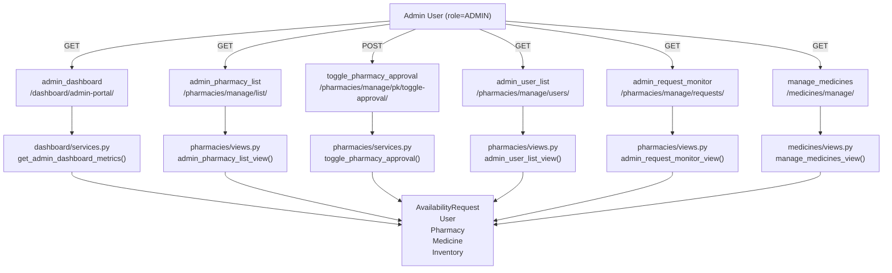

# Admin Portal Implementation Report
**MediFind – Phase 7: Administrative Portal & Governance**

---

## 1. Overview

Phase 7 enhances the MediFind Django administrative portal into a professional, secure, data-driven governance dashboard. All changes preserve the existing 6-app modular monolith and use only real ORM queries — no hardcoded or dummy statistics.

---

## 2. Architecture

---

## 3. Admin Views

| View | URL Name | URL Pattern | Access |
|------|----------|-------------|--------|
| `admin_dashboard_view` | `admin_dashboard` | `/dashboard/admin-portal/` | `@admin_required` |
| `admin_pharmacy_list_view` | `admin_pharmacy_list` | `/pharmacies/manage/list/` | `@admin_required` |
| `toggle_pharmacy_approval_view` | `toggle_pharmacy_approval` | `/pharmacies/manage/<pk>/toggle-approval/` | `@admin_required` + `@require_POST` |
| `admin_user_list_view` | `admin_user_list` | `/pharmacies/manage/users/` | `@admin_required` |
| `admin_request_monitor_view` | `admin_request_monitor` | `/pharmacies/manage/requests/` | `@admin_required` |
| `manage_medicines_view` | `manage_medicines` | `/medicines/manage/` | `@admin_required` |

---

## 4. KPI Metrics — `get_admin_dashboard_metrics()`

All metrics computed using consolidated ORM aggregates (3 queries total for counts):

| Context Variable | Description | Source |
|-----------------|-------------|--------|
| `total_customers` | Users with `role='CUSTOMER'` | `User.objects.aggregate(...)` |
| `total_pharmacy_owners` | Users with `role='PHARMACY'` | `User.objects.aggregate(...)` |
| `approved_pharmacies` | Pharmacies with `is_approved=True` | `Pharmacy.objects.aggregate(...)` |
| `pending_approvals` | Pharmacies with `is_approved=False` | `Pharmacy.objects.aggregate(...)` |
| `total_medicines` | Total Medicine catalogue entries | `Medicine.objects.count()` |
| `total_inventory` | Total Inventory records | `Inventory.objects.count()` |
| `active_requests` | Requests with `status='PENDING'` | `AvailabilityRequest.objects.aggregate(...)` |
| `completed_requests` | CONFIRMED + UNAVAILABLE requests | Computed from aggregate |
| `cancelled_requests` | Requests with `status='CANCELLED'` | `AvailabilityRequest.objects.aggregate(...)` |
| `total_requests` | All AvailabilityRequest records | `AvailabilityRequest.objects.aggregate(...)` |
| `pending_pharmacies_list` | 5 most recent unapproved pharmacies | Filtered queryset |
| `recent_requests` | 6 most recent platform requests | Ordered queryset |
| `cat_labels` / `cat_data` | Medicine category distribution | Annotated queryset for Chart.js |

---

## 5. Files Modified

### Backend

| File | Change |
|------|--------|
| `dashboard/services.py` | Enhanced `get_admin_dashboard_metrics()` with request status breakdown and pharmacy owner count |
| `pharmacies/views.py` | Enhanced `admin_pharmacy_list_view` (search, filter, pagination); added `admin_user_list_view`, `admin_request_monitor_view` |
| `pharmacies/urls.py` | Added 2 new URL patterns: `admin_user_list`, `admin_request_monitor` |
| `medicines/views.py` | Enhanced `manage_medicines_view` with category filter + pagination |

### Templates

| File | Change |
|------|--------|
| `templates/dashboard/admin_dashboard.html` | 8 stat tiles; CANCELLED badge; "Manage Users" + "Monitor Requests" quick actions |
| `templates/pharmacies/admin_list.html` | Search bar, registered date column, pagination, total_count tabs |
| `templates/pharmacies/admin_user_list.html` | NEW — user management table with role filters, search, pagination |
| `templates/pharmacies/admin_request_monitor.html` | NEW — request monitor with status tabs, search, pagination |
| `templates/medicines/manage_list.html` | Category dropdown filter, pagination, total_count |

### Tests & Docs

| File | Change |
|------|--------|
| `tests/test_admin_portal.py` | NEW — 15 test vectors (Phase 7) |
| `docs/ADMIN_PORTAL_IMPLEMENTATION_REPORT.md` | This document |
| `docs/PHARMACY_GOVERNANCE_DOCUMENTATION.md` | Governance workflow documentation |
| `docs/ADMIN_SECURITY_REVIEW.md` | Security architecture review |
| `docs/ADMIN_TEST_REPORT.md` | Test execution report |

---

## 6. Admin Dashboard Stat Tiles (Phase 7)

The admin dashboard now shows 8 tiles in responsive `col-md-3 col-xl` layout:

1. **Patients / Seekers** → `total_customers` (blue)
2. **Pharmacy Owners** → `total_pharmacy_owners` (cyan)
3. **Approved Stores** → `approved_pharmacies` (green)
4. **Pending Verification** → `pending_approvals` (amber)
5. **Catalogue Medicines** → `total_medicines` (teal secondary)
6. **Active Inquiries** → `active_requests` (amber — PENDING only)
7. **Completed Requests** → `completed_requests` (green — CONFIRMED + UNAVAILABLE)
8. **Inventory Stock Lots** → `total_inventory` (dark accent)

---

## 7. New Feature: User Management Portal

**URL**: `/pharmacies/manage/users/`  
**View**: `admin_user_list_view`

- Lists all non-admin users (CUSTOMER + PHARMACY roles)
- Role filter tabs: All / Customer / Pharmacy
- Full-text search: username, email, first name, last name, phone number
- Pagination: 20 users per page
- Columns: User, Role, Email, Phone, Joined

---

## 8. New Feature: Request Monitoring Portal

**URL**: `/pharmacies/manage/requests/`  
**View**: `admin_request_monitor_view`

- Lists all `AvailabilityRequest` records across the platform
- Status filter tabs: All / Pending / Confirmed / Unavailable / Cancelled
- Full-text search: customer username, pharmacy name, medicine name
- Pagination: 15 requests per page
- Columns: ID, Customer, Medicine, Pharmacy, Qty, Status, Date

---

## 9. Enhanced: Medicine Catalogue Management

**URL**: `/medicines/manage/`  
**View**: `manage_medicines_view`

- Category filter dropdown (from `Medicine.CATEGORY_CHOICES`)
- Pagination: 20 medicines per page
- Shows `total_count` and `query_string` for consistent pagination links

---

## 10. Constraints Honoured

- ✅ No new Django apps created
- ✅ No new database models added
- ✅ No destructive migrations
- ✅ No hardcoded/dummy statistics
- ✅ All 6 existing apps preserved
- ✅ Existing URL names unbroken
- ✅ Existing business workflows preserved
