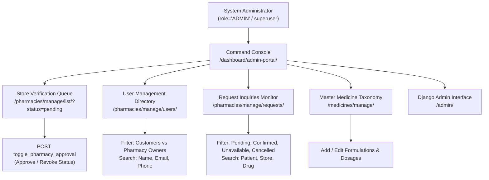

# Administrative Workflow Test Report
**MediFind – Phase 9: End-to-End Governance & Operations Validation**

---

## 1. Overview

This report documents the verification of all administrative oversight tools, pharmacy accreditation vetting, user account administration, platform inquiry monitoring, and global medicine taxonomy management.

---

## 2. Governance Operations Architecture

---

## 3. Step-by-Step Test Execution & Findings

| Step | Action | Method & Endpoint | Expected Behaviour | Actual Result |
|:----:|--------|-------------------|--------------------|:-------------:|
| **1** | Admin Authentication | `POST /accounts/login/` | Identifies `role='ADMIN'` or superuser, dispatches to operations console | PASS |
| **2** | Role-Based Guard | `GET /dashboard/admin-portal/` | Customers and pharmacy owners redirected to their respective dashboards | PASS |
| **3** | Operations KPI Tiles | `GET /dashboard/admin-portal/` | 8 real-time aggregated metrics (Patients, Stores, Catalogue, Inquiries) | PASS |
| **4** | Verification Queue | `GET /pharmacies/manage/list/?status=pending` | Displays unapproved stores awaiting vetting with license / registration details | PASS |
| **5** | Store Accreditation | `POST /pharmacies/manage/<id>/toggle-approval/` | Sets `is_approved=True`, logs admin username, alerts pharmacy owner | PASS |
| **6** | Store Revocation | `POST /pharmacies/manage/<id>/toggle-approval/` | Sets `is_approved=False`, immediately hides store from public discovery | PASS |
| **7** | Method Restriction | `GET /pharmacies/manage/<id>/toggle-approval/` | GET method rejected with **HTTP 405 Method Not Allowed** | PASS |
| **8** | User Administration | `GET /pharmacies/manage/users/` | Paginated listing of customer and pharmacy accounts with role filters and search | PASS |
| **9** | Request Monitoring | `GET /pharmacies/manage/requests/` | Real-time audit of all platform availability requests across all stores | PASS |
| **10** | Drug Taxonomy Management | `GET /medicines/manage/` | Filter formulations by category, search by brand/generic name, pagination | PASS |
| **11** | Drug Registration | `POST /medicines/add/` | Adds new therapeutic formulation to global catalog; validated with forms | PASS |

---

## 4. Administrative Security Audit Summary

1. **Authorization Enforcement**: Every administrative endpoint is wrapped with `@login_required` and `@admin_required`. Non-admin accounts cannot access governance URLs.
2. **State Mutation Safeguards**: The pharmacy approval toggle strictly requires HTTP POST (`@require_POST`) with CSRF token verification.
3. **Data Integrity**: Administrative views utilize read-only queries for inspection and safe transactional methods for status mutations.
