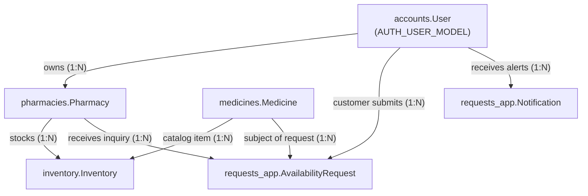
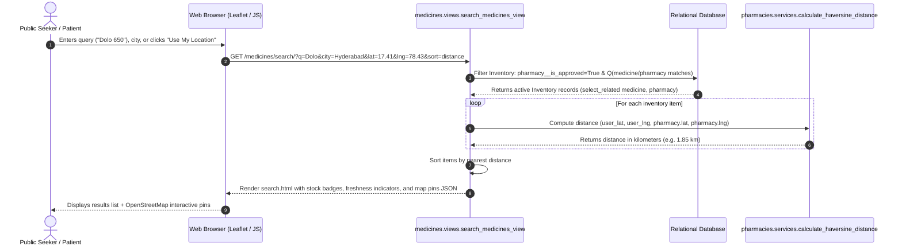
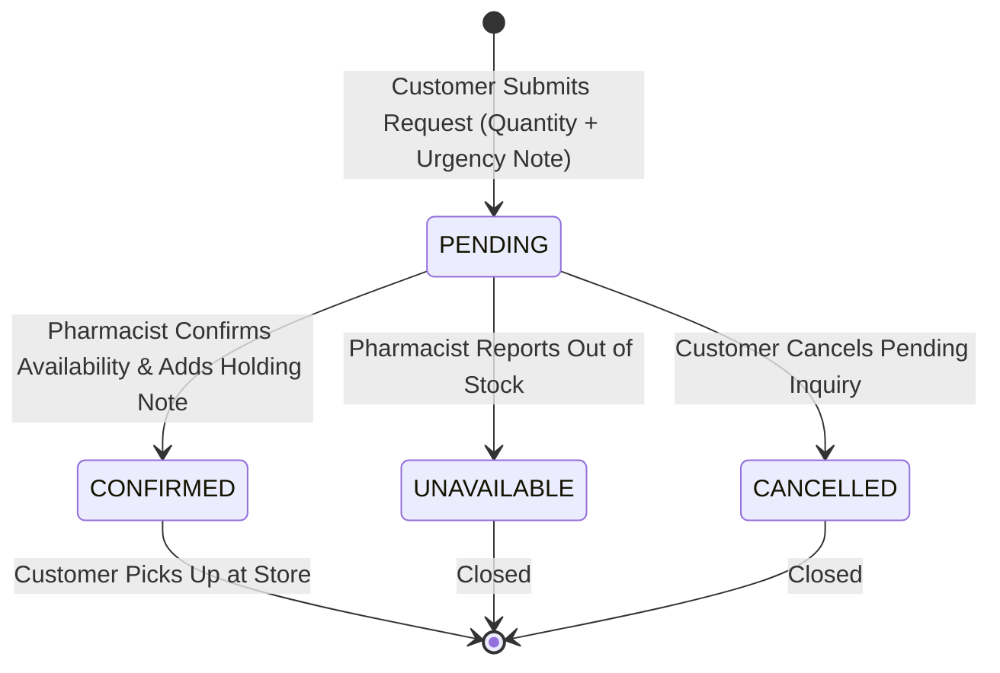

# MediFind – Current Architecture Specification

**Author**: Senior Python Full-Stack Developer & Django Software Architect  
**Architecture Pattern**: Three-Tier Modular Monolith  
**Framework**: Django 5.2.16 LTS | Python 3.11.9  
**Presentation**: Bootstrap 5.3.3, Leaflet 1.9.4, Chart.js, Vanilla ES6+  
**Data Storage**: SQLite 3 (PostgreSQL Schema Compatible)  

---

## 1. Architectural Overview

MediFind is structured as a **Three-Tier Modular Monolithic Architecture**. This pattern balances maintainability, deployment simplicity, rapid iteration, and strict separation of concerns without the network latency and operational complexity of microservices.

```
+=======================================================================+
|                     TIER 1: PRESENTATION LAYER                        |
|  - Django Template Language (DTL)                                     |
|  - Bootstrap 5.3.3 + Bootstrap Icons 1.11.3                           |
|  - Leaflet.js 1.9.4 & OpenStreetMap (Cartographic Visualization)      |
|  - Chart.js (Doughnut & Bar Operational Analytics)                    |
|  - Custom Healthcare Design System (styles.css)                       |
+=======================================================================+
                                   ▲
                                   │ HTTP Request / Response (HTML + JSON)
                                   ▼
+=======================================================================+
|                     TIER 2: APPLICATION LAYER                         |
|                    (Django 5.2 LTS Web Framework)                     |
|                                                                       |
|  [accounts]       Identity, Custom User Model, Session Management     |
|  [medicines]      Master Drug Catalog, Taxonomy, Search Engine        |
|  [pharmacies]     Store Entities, Spatial Coordinates, Approval       |
|  [inventory]      Stock Thresholds, Lots, Multi-Tenant Isolation      |
|  [requests_app]   Availability Inquiries, Response Workflow, Alerts   |
|  [dashboard]      Dispatcher, Analytics, Role-Tailored Consoles       |
|                                                                       |
|  Services: Haversine Great-Circle Engine (pharmacies.services)        |
|  Security: RBAC Decorators (@customer, @pharmacy, @admin)             |
+=======================================================================+
                                   ▲
                                   │ Django Object-Relational Mapping (ORM)
                                   ▼
+=======================================================================+
|                        TIER 3: DATA LAYER                             |
|                (Relational Database Management System)                |
|                                                                       |
|  - Custom User (`accounts_user`): Roles (CUSTOMER, PHARMACY, ADMIN)   |
|  - Pharmacy (`pharmacies_pharmacy`): Store Metadata & Coordinates     |
|  - Medicine (`medicines_medicine`): Master Formulations Directory     |
|  - Inventory (`inventory_inventory`): Composite Unique Stock Lots     |
|  - AvailabilityRequest (`requests_app_availabilityrequest`): State    |
|  - Notification (`requests_app_notification`): Alert Message Queue    |
+=======================================================================+
```

---

## 2. Domain Application Separation of Concerns



### 2.1 Application Dependency Matrix

1. **`accounts`**:
   - Depends only on Django's core authentication and `requests_app.Notification`.
   - Defines custom `User` inheriting `AbstractUser`.
   - Exports view security decorators: `@customer_required`, `@pharmacy_required`, `@admin_required`.
2. **`medicines`**:
   - Master drug directory independent of store logistics.
   - Depends on `inventory.Inventory` for aggregating available stock listings and `pharmacies.services` for spatial calculations.
3. **`pharmacies`**:
   - Depends on `accounts.User` for ownership mapping.
   - Houses mathematical spatial calculation services (`pharmacies/services.py`).
4. **`inventory`**:
   - Pure bridge relationship connecting `pharmacies.Pharmacy` with `medicines.Medicine`.
   - Enforces stock status state machine and multi-tenant security guards.
5. **`requests_app`**:
   - Implements communication lifecycle between Seekers (`User`), Stores (`Pharmacy`), and Products (`Medicine`).
   - Manages asynchronous user notifications (`Notification`).
6. **`dashboard`**:
   - Top-level aggregator consuming all five lower-tier modules to present operational metrics, quick actions, and data visualizations.

---

## 3. End-to-End Business Workflow Architectures

### 3.1 Public Medicine Discovery & Spatial Filtering Workflow



### 3.2 Availability Inquiry & Pharmacist Holding State Machine



---

## 4. Security & Isolation Architecture

1. **Role-Based Access Control (RBAC)**:
   - Evaluated at the HTTP view dispatch boundary through custom wrappers in `accounts/decorators.py`.
   - Unauthenticated requests redirect to login with `?next=`.
   - Authenticated users with incompatible roles (e.g. Customer accessing `/inventory/`) are redirected to `/dashboard/` with flash error notices.
2. **Multi-Tenant Isolation (IDOR Defense)**:
   - Pharmacy management views (`inventory_edit`, `inventory_delete`, `respond_request`) bind all queries directly to the authenticated owner's pharmacy (`pharmacy=request.user.pharmacies.first()`). Direct parameter manipulation produces an HTTP 404 response.
3. **Public Search Sanitization**:
   - Public search queries unconditionally enforce `pharmacy__is_approved=True`. Unapproved or rejected pharmacy stores and their stock remain completely isolated.
4. **Data Integrity Guards**:
   - `unique_together = ('pharmacy', 'medicine')` prevents inventory duplicates.
   - `MinValueValidator(0)` on Inventory and `MinValueValidator(1)` on Requests prevent negative and zero anomalies.

---

## 5. Technology Stack Specifications

- **Backend Runtime**: Python 3.11.9
- **Web Framework**: Django 5.2.16 LTS
- **Relational Storage**: SQLite 3 (Zero configuration, development baseline)
- **Styling Architecture**: Bootstrap 5.3.3 + Custom CSS Variables (`styles.css`)
- **Icons**: Bootstrap Icons 1.11.3 (SVG icon font)
- **Map & Geo Engine**: Leaflet 1.9.4 + OpenStreetMap Tiles
- **Data Visualization**: Chart.js (Doughnut for inventory distribution, Bar for catalog categories)
