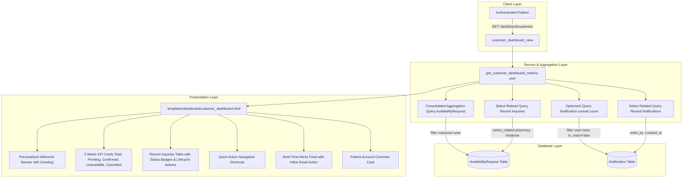

# Customer Dashboard Architecture & Implementation Report

## 1. Executive Summary

This report documents the architectural design, query optimization, security posture, and UI/UX modernization executed in **Phase 5: Customer Dashboard Enhancement** of the **MediFind** healthcare platform.

The patient portal was elevated into a database-driven dashboard. All metrics, recent inquiries, status breakdowns, and alert feeds are computed dynamically from actual database records scoped strictly to the authenticated customer.

---

## 2. Customer Dashboard Architecture



---

## 3. Key Enhancements Delivered

### 3.1 Personalized Welcome Banner
- **Time-Based Greeting**: Computes contextual greetings (`Good morning`, `Good afternoon`, `Good evening`) based on the patient's local timezone.
- **Patient Identity**: Renders customer's full name (`user.get_full_name()`) with fallback to `first_name` or `username`.
- **Portal Badges**: Displays *"Patient Portal"* role badge and *"Member since [Month Year]"* registration date.
- **Top Shortcuts**: Instant navigation to *Profile & Security*, *Notification Center* (with live unread counter pill), and *Search Medicines*.

### 3.2 Database-Driven KPI Metric Tiles
Replaces static or fragmented data with verified database aggregates scoped strictly to `customer=request.user`:
- **Total Inquiries Sent**: Total number of availability requests ever created by the patient.
- **Pending Review**: Inquiries awaiting pharmacist evaluation (`status='PENDING'`).
- **Confirmed In Stock**: Verified availability confirmations with pickup instructions (`status='CONFIRMED'`).
- **Reported Unavailable**: Inquiries where pharmacy reported out-of-stock (`status='UNAVAILABLE'`).
- **Cancelled Inquiries**: Inquiries cancelled by the customer (`status='CANCELLED'`).

### 3.3 Recent Inquiries Activity Table
- Formulations displayed with Brand Name, Dosage Form, and Strength.
- Pharmacy facility linked directly to public store profile with city and phone contact.
- Formatted status badges: `badge-status-pending`, `badge-status-confirmed`, `badge-status-unavailable`, and `badge-secondary`.
- Contextual action buttons:
  - If `PENDING`: Immediate, CSRF-protected *"Cancel"* action with JavaScript confirmation.
  - If `CONFIRMED`: Direct *"Call Store"* (`tel:`) button to arrange prescription hold.
  - If `UNAVAILABLE` or `CANCELLED`: Quick *"View Store"* link.

### 3.4 Quick Action Shortcuts Grid
One-click navigational cards to core patient workflows:
1. **Search Medicines**: Browse catalog and check live pharmacy inventory lots.
2. **Nearby Pharmacies**: Discover licensed pharmacies within proximity radius (5–50 km).
3. **My Inquiries History**: Full historical record of requests with status filtering and pagination.
4. **Profile & Security**: Update contact numbers, email, and security credentials.

### 3.5 Real-Time Alerts Feed
- Displays the 5 most recent notifications.
- Visual distinction between read and unread alerts.
- Inline form action to mark individual alerts as read without navigating away.
- Shortcut to the full Notification Center.

---

## 4. Backend Query Optimization & Performance

### 4.1 Consolidated Metric Aggregation
Rather than issuing multiple separate count queries (e.g., `count()`, `filter().count()`), `dashboard/services.py:get_customer_dashboard_metrics` consolidates all status counters into a **single SQL query**:
```python
req_counts = AvailabilityRequest.objects.filter(customer=user).aggregate(
    total=Count('id'),
    pending=Count('id', filter=Q(status='PENDING')),
    confirmed=Count('id', filter=Q(status='CONFIRMED')),
    unavailable=Count('id', filter=Q(status='UNAVAILABLE')),
    cancelled=Count('id', filter=Q(status='CANCELLED')),
)
```
- **Performance Impact**: Eliminates 4 redundant round-trips to the database on every dashboard load.

### 4.2 N+1 Query Elimination
- Recent inquiries apply `.select_related('pharmacy', 'medicine')`, ensuring that rendering pharmacy names, cities, phone numbers, and medicine dosage forms requires **zero additional SQL queries per row**.

---

## 5. Security & Multi-Tenant Isolation

1. **Authentication Enforcement**: `@login_required` guards `customer_dashboard_view`. Anonymous users are redirected via 302 to the login route with safe `?next=` preservation.
2. **Strict Backend Scoping**: All queries filter strictly on `customer=request.user` or `user=request.user`. Client-supplied IDs in query strings or form posts are never trusted for ownership.
3. **State Mutation via POST**: All state mutations (cancelling requests, marking notifications read) require HTTP POST with Django CSRF token validation (`@require_POST`).
