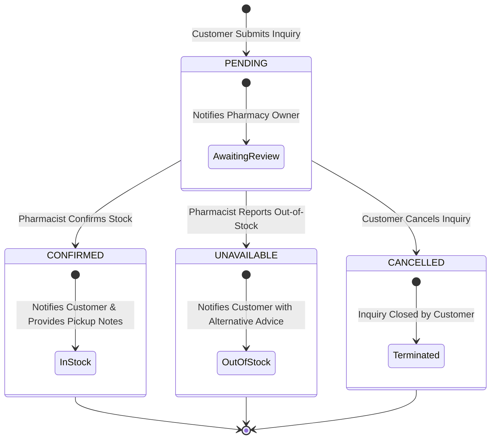

# Customer Availability Request Tracking Specification

## 1. Overview & Business Objectives

The **Availability Request System** allows patients to verify prescription drug availability at participating local pharmacies before leaving home. It eliminates store-to-store exhaustion, connects patients directly with pharmacy operators, and provides clear tracking across the inquiry lifecycle.

---

## 2. Request Lifecycle & State Machine



### 2.1 Allowed State Transitions & Permissions

| From State | To State | Initiator | Condition / Rule |
| :--- | :--- | :--- | :--- |
| `[None]` | `PENDING` | Authenticated Customer | Must request $\ge 1$ unit; target pharmacy must be approved (`is_approved=True`); customer cannot request from own pharmacy. |
| `PENDING` | `CONFIRMED` | Pharmacy Owner | Target pharmacy owner only (`pharmacy.owner == user`). Generates alert to customer. |
| `PENDING` | `UNAVAILABLE` | Pharmacy Owner | Target pharmacy owner only (`pharmacy.owner == user`). Generates alert to customer. |
| `PENDING` | `CANCELLED` | Inquiring Customer | Inquiring customer only (`req.customer == user`). Permitted **only** when status is `PENDING`. |
| `CONFIRMED` | Any | None | Terminal state. Cannot be cancelled. |
| `UNAVAILABLE` | Any | None | Terminal state. Cannot be cancelled. |
| `CANCELLED` | Any | None | Terminal state. Closed. |

---

## 3. Inquiry History Interface (`/requests/my-requests/`)

The inquiry history view (`customer_requests_list_view`) provides complete operational visibility for patients:

### 3.1 Status Breakdown Filter Pills
Dynamic pill badges display live database counts:
- **All Inquiries** (`?status=`): Complete history.
- **Pending Review** (`?status=PENDING`): Awaiting pharmacist response.
- **Confirmed In Stock** (`?status=CONFIRMED`): Verified availability.
- **Unavailable** (`?status=UNAVAILABLE`): Stock depleted or unstocked.
- **Cancelled** (`?status=CANCELLED`): Inquiries cancelled prior to response.

### 3.2 Pagination & Filter Preservation
- **Page Size**: 10 records per page using Django's `Paginator`.
- **Query Parameter Preservation**: Active filters (e.g., `?status=CONFIRMED`) are URL-encoded into pagination navigation links (`?status=CONFIRMED&page=2`), preventing filter resets during multi-page browsing.

### 3.3 Data Model Contract
```python
class AvailabilityRequest(models.Model):
    customer = models.ForeignKey(settings.AUTH_USER_MODEL, related_name='customer_requests')
    pharmacy = models.ForeignKey(Pharmacy, related_name='pharmacy_requests')
    medicine = models.ForeignKey(Medicine, related_name='availability_requests')
    quantity_requested = models.PositiveIntegerField(default=1)
    request_message = models.TextField(blank=True)
    status = models.CharField(max_length=20, choices=STATUS_CHOICES, default='PENDING')
    pharmacy_response = models.TextField(blank=True)
    created_at = models.DateTimeField(auto_now_add=True)
    updated_at = models.DateTimeField(auto_now=True)
```

---

## 4. Security & Access Control

1. **Role Restriction**: `@customer_required` ensures only authenticated customer users can view the patient inquiries list or submit availability requests.
2. **Strict Ownership Verification**:
   - `AvailabilityRequest.objects.filter(customer=request.user)` ensures no customer can inspect another patient's inquiry history.
3. **Cancellation Protection**:
   - `cancel_availability_inquiry(request_id, customer)` validates `req.customer == customer` and `req.status == 'PENDING'`. Attempts by unauthorized users raise HTTP 404; attempts to cancel confirmed or closed inquiries return descriptive validation errors.
