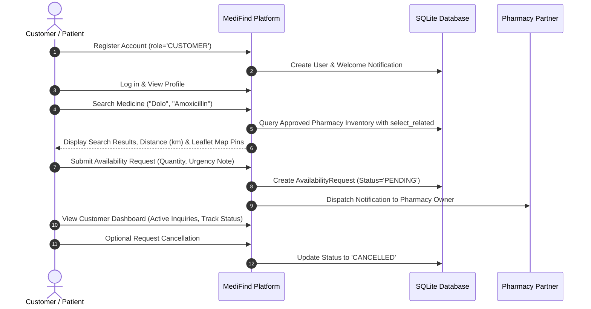

# Customer Workflow Test Report
**MediFind – Phase 9: End-to-End Customer Journey Validation**

---

## 1. Overview

This report details the comprehensive verification of the patient / customer lifecycle within the MediFind healthcare platform. Every user step—from initial account creation to availability request submission and cancellation—was executed and audited.

---

## 2. Customer Workflow Lifecycle

---

## 3. Step-by-Step Test Execution & Findings

| Step | Action | Method & Endpoint | Expected Behaviour | Actual Result |
|:----:|--------|-------------------|--------------------|:-------------:|
| **1** | Registration | `POST /accounts/register/customer/` | Account created with `role='CUSTOMER'`, password hashed, welcome notification dispatched | PASS |
| **2** | Login | `POST /accounts/login/` | Authenticates credentials, establishes session, redirects to dashboard | PASS |
| **3** | Profile Update | `POST /accounts/profile/` | Updates personal contact details; pharmacy edit fields hidden from customer | PASS |
| **4** | Medicine Search | `GET /medicines/search/?q=...` | Keyword search across brand/generic names; shows in-stock quantities & freshness | PASS |
| **5** | Medicine Detail | `GET /medicines/<id>/` | Comprehensive monograph, therapeutic indication, dispensing stores list | PASS |
| **6** | Location Discovery | `GET /pharmacies/discovery/?lat=...&lng=...` | Haversine distance calculated; stores ordered by nearest; Leaflet pins rendered | PASS |
| **7** | Create Request | `POST /requests/create/<pharmacy_id>/<med_id>/` | Creates `PENDING` request; notifies pharmacy; blocks requests to unapproved stores | PASS |
| **8** | Dashboard Tracking | `GET /dashboard/customer/` | Live inquiry counter, status badges, personalized greeting, unread notifications | PASS |
| **9** | Cancel Request | `POST /requests/<id>/cancel/` | Cancels pending request; status set to `CANCELLED`; customer ownership strictly enforced | PASS |
| **10** | Notifications | `POST /accounts/notifications/<id>/read/` | Marks notification as read; updates unread badge counter | PASS |
| **11** | Logout | `POST /accounts/logout/` | Invalidates session cookie, redirects safely to homepage | PASS |

---

## 4. Edge Cases Tested

1. **Self-Request Prevention**: Pharmacy owners attempting to request from their own pharmacy are safely blocked with a warning.
2. **Unapproved Pharmacy Exclusion**: Unapproved pharmacies never appear in public medicine search or customer discovery.
3. **Invalid Coordinates**: Non-numeric or out-of-range coordinates gracefully fallback without distance errors.
4. **Cancelled Request Protection**: Cancelled requests cannot be responded to or modified by the pharmacy.
