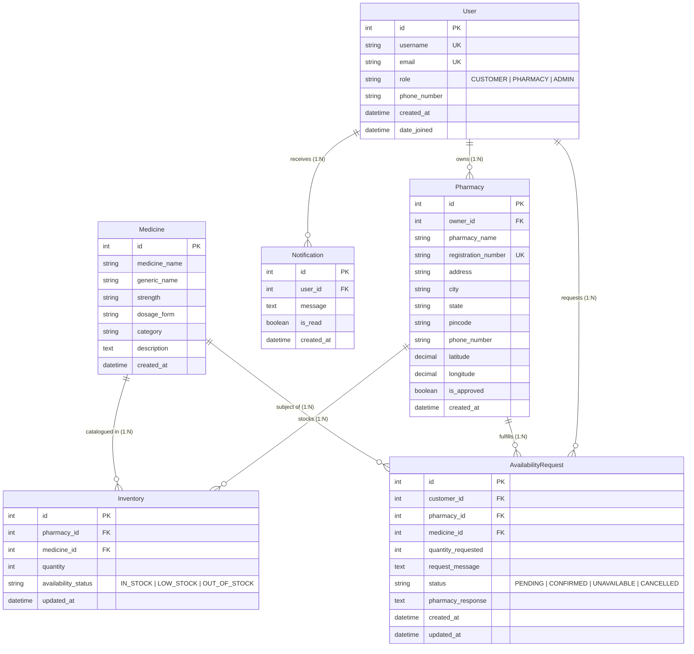

# Database Structure Audit Report
**MediFind – Phase 8: Database Optimization & Performance Improvement**

---

## 1. Executive Summary

This audit assesses the database schema, entity relationships, model validation, referential integrity, indexing strategies, and migration history across all six applications comprising MediFind:
- `accounts`
- `medicines`
- `pharmacies`
- `inventory`
- `requests_app`
- `dashboard`

The audit confirms that the existing architecture is sound, modular, and normalized (3NF). Critical optimization opportunities—primarily missing database indexes on high-throughput query columns and unindexed foreign key lookups—were identified and remediated through safe, non-destructive migrations.

---

## 2. Entity-Relationship Model & Keys

---

## 3. Detailed Audit by Application

### 3.1 `accounts`
- **Model**: `User` (extends `AbstractUser`)
- **Primary Key**: `id` (Auto-field, integer PK)
- **Keys & Constraints**:
  - `username`: unique, indexed by default.
  - `email`: `EmailField(unique=True, verbose_name="Email Address")`.
  - `role`: `CharField(max_length=20, choices=ROLE_CHOICES, default='CUSTOMER', db_index=True)`.
- **Referential Integrity**:
  - Acts as target for foreign keys from `Pharmacy` (owner), `AvailabilityRequest` (customer), `Notification` (user). All configured with `on_delete=models.CASCADE`.
- **Identified Improvement**:
  - Added composite index `user_role_joined_idx` on `('role', '-date_joined')` to optimize administrative user directory filtering and sorting.

### 3.2 `medicines`
- **Model**: `Medicine`
- **Primary Key**: `id`
- **Keys & Constraints**:
  - `medicine_name`: `CharField(max_length=200, db_index=True)`.
  - `generic_name`: `CharField(max_length=200, db_index=True)`.
  - `category`: `CharField(max_length=100, choices=CATEGORY_CHOICES, db_index=True)`.
  - `dosage_form`: `CharField(max_length=100, choices=DOSAGE_FORM_CHOICES)`.
- **Audit Findings**:
  - `dosage_form` is heavily filtered in discovery (`search_medicine_inventory`), but had no index.
  - Catalog browsing orders by `medicine_name` within `category`.
- **Remediation**:
  - Added `db_index=True` to `dosage_form`.
  - Added composite index `med_cat_name_idx` on `('category', 'medicine_name')`.
  - Added composite index `med_dosage_cat_idx` on `('dosage_form', 'category')`.

### 3.3 `pharmacies`
- **Model**: `Pharmacy`
- **Primary Key**: `id`
- **Keys & Constraints**:
  - `owner`: `ForeignKey(User, on_delete=CASCADE, related_name='pharmacies')`.
  - `registration_number`: `CharField(max_length=100, unique=True, db_index=True)`.
  - `pharmacy_name`: `CharField(max_length=200)`.
  - `city`: `CharField(max_length=100, db_index=True)`.
  - `pincode`: `CharField(max_length=20, db_index=True)`.
  - `is_approved`: `BooleanField(default=False, db_index=True)`.
- **Audit Findings**:
  - `pharmacy_name` had no index despite being queried in full-text and partial match filters.
  - Queries almost always filter `is_approved=True` alongside `city` or `pincode`.
  - Dashboards order pharmacies by `-created_at`.
- **Remediation**:
  - Added `db_index=True` to `pharmacy_name`.
  - Added composite index `pharm_appr_city_idx` on `('is_approved', 'city')`.
  - Added composite index `pharm_appr_pincode_idx` on `('is_approved', 'pincode')`.
  - Added composite index `pharm_appr_created_idx` on `('is_approved', '-created_at')`.

### 3.4 `inventory`
- **Model**: `Inventory`
- **Primary Key**: `id`
- **Keys & Constraints**:
  - `pharmacy`: `ForeignKey(Pharmacy, on_delete=CASCADE, related_name='inventories')`.
  - `medicine`: `ForeignKey(Medicine, on_delete=CASCADE, related_name='pharmacy_inventories')`.
  - `unique_together = ('pharmacy', 'medicine')`: strictly prevents duplicate catalog entries per store.
  - `quantity`: `PositiveIntegerField(default=0, validators=[MinValueValidator(0)])`.
  - `availability_status`: `CharField(max_length=20, db_index=True)`.
  - `updated_at`: `DateTimeField(auto_now=True)`.
- **Model Validation**:
  - Overridden `clean()` and `save()` enforce non-negative quantities and auto-compute `availability_status` (IN_STOCK > 10, LOW_STOCK 1-10, OUT_OF_STOCK 0).
- **Audit Findings**:
  - Default ordering is `['-updated_at']`. Without an index on `updated_at`, sorting triggers database file sorts.
  - Dashboard low-stock queries filter by `pharmacy` and `availability_status`.
- **Remediation**:
  - Added `db_index=True` to `updated_at`.
  - Added composite index `inv_pharm_status_idx` on `('pharmacy', 'availability_status')`.
  - Added composite index `inv_pharm_updated_idx` on `('pharmacy', '-updated_at')`.
  - Added composite index `inv_status_updated_idx` on `('availability_status', '-updated_at')`.

### 3.5 `requests_app`
- **Model 1**: `AvailabilityRequest`
  - `customer`: `ForeignKey(User, on_delete=CASCADE)`.
  - `pharmacy`: `ForeignKey(Pharmacy, on_delete=CASCADE)`.
  - `medicine`: `ForeignKey(Medicine, on_delete=CASCADE)`.
  - `quantity_requested`: `PositiveIntegerField(default=1, validators=[MinValueValidator(1)])`.
  - `status`: `CharField(max_length=20, db_index=True)`.
  - `created_at`: `DateTimeField(auto_now_add=True)`.
  - **Audit Findings**: Customer history and pharmacy inbox query by `(customer, status, -created_at)` and `(pharmacy, status, -created_at)`.
  - **Remediation**: Added `db_index=True` to `created_at`, plus composite indexes on `('customer', 'status')`, `('customer', '-created_at')`, `('pharmacy', 'status')`, and `('pharmacy', '-created_at')`.
- **Model 2**: `Notification`
  - `user`: `ForeignKey(User, on_delete=CASCADE)`.
  - `is_read`: `BooleanField(default=False, db_index=True)`.
  - `created_at`: `DateTimeField(auto_now_add=True)`.
  - **Audit Findings**: Unread counter executes `filter(user=user, is_read=False).count()` on every authenticated page load.
  - **Remediation**: Added `db_index=True` to `created_at`, plus composite indexes on `('user', 'is_read')` and `('user', '-created_at')`.

### 3.6 `dashboard`
- Contains analytics services and views. Has no independent persistent database models; operations are executed as aggregated views over the other five application tables.

---

## 4. Migration History & Integrity

All schema updates have been applied as incremental, non-destructive migrations:
- `accounts`: `0001_initial` → `0002_alter_user_options_user_user_role_joined_idx`
- `medicines`: `0001_initial` → `0002_alter_medicine_dosage_form_medicine_med_cat_name_idx_and_more`
- `pharmacies`: `0001_initial` → `0002_alter_pharmacy_pharmacy_name_and_more`
- `inventory`: `0001_initial` → `0002_alter_inventory_updated_at_and_more`
- `requests_app`: `0001_initial` → `0002_alter_availabilityrequest_created_at_and_more`

All 5 migrations added only indexes (`Create index` and `Alter field db_index=True`). Zero columns removed, zero constraints broken, zero data dropped.
