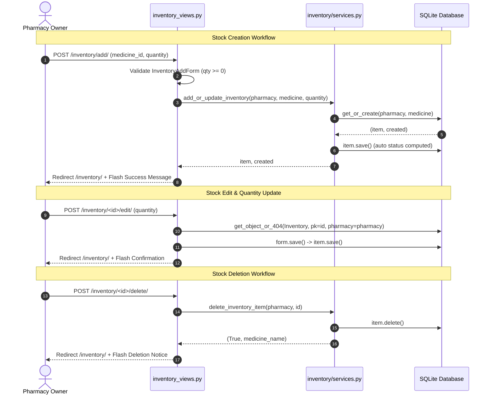

# Pharmacy Inventory Management Documentation

## 1. Overview & Data Model

The **MediFind** Inventory Management system empowers pharmacy operators to maintain real-time medicine availability records. By decoupling master medicine definitions (catalog) from pharmacy stock records (inventory), multiple dispensaries can independently stock the same formulation without data redundancy.

---

## 2. Inventory Data Model

```python
class Inventory(models.Model):
    STATUS_CHOICES = (
        ('IN_STOCK', 'In Stock'),
        ('LOW_STOCK', 'Low Stock (< 10 units)'),
        ('OUT_OF_STOCK', 'Out of Stock'),
    )

    pharmacy = models.ForeignKey(Pharmacy, on_delete=models.CASCADE, related_name='inventories')
    medicine = models.ForeignKey(Medicine, on_delete=models.CASCADE, related_name='pharmacy_inventories')
    quantity = models.PositiveIntegerField(default=0, validators=[MinValueValidator(0)])
    availability_status = models.CharField(max_length=20, choices=STATUS_CHOICES, default='OUT_OF_STOCK', db_index=True)
    updated_at = models.DateTimeField(auto_now=True)

    class Meta:
        unique_together = ('pharmacy', 'medicine')
        ordering = ['-updated_at']
```

### 2.1 Uniqueness Guarantee
- The `unique_together = ('pharmacy', 'medicine')` database constraint guarantees that a single pharmacy cannot possess multiple duplicate inventory records for the same medication.
- Submitting an existing medicine via the inventory creation interface automatically detects the prior record and updates its quantity rather than causing database collision or duplication.

### 2.2 Automated Stock Classification
On every `save()`, the model validates stock count and calculates `availability_status` synchronously:
- `quantity > 10`: `IN_STOCK`
- `1 <= quantity <= 10`: `LOW_STOCK`
- `quantity == 0`: `OUT_OF_STOCK`

---

## 3. Inventory CRUD Workflows



---

## 4. Search, Filtering, and Sorting Architecture

The `get_filtered_inventory` service delivers optimized queries:
- **Search (`q`)**: Performs case-insensitive matching across `medicine__medicine_name__icontains` and `medicine__generic_name__icontains`.
- **Status Filter (`status`)**: Filters specifically by `availability_status` (`IN_STOCK`, `LOW_STOCK`, `OUT_OF_STOCK`).
- **Sorting (`sort`)**:
  - `updated`: Ordered by `-updated_at` (newest modifications first).
  - `name`: Ordered by `medicine__medicine_name` (alphabetical A-Z).
  - `qty_asc`: Ordered by `quantity` (lowest stock first for restocking passes).
  - `qty_desc`: Ordered by `-quantity` (highest stock first).
- **Pagination**: Django `Paginator` configured to 10 records per page. Query string parameters are preserved across pagination links to maintain search criteria while navigating pages.
