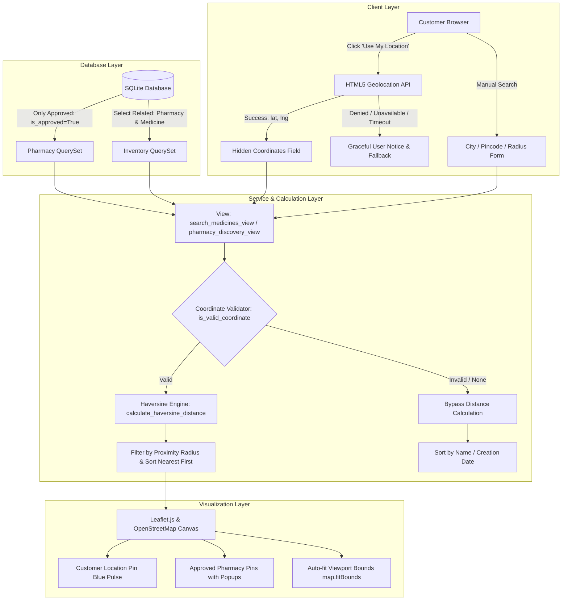

# Location Discovery & Geospatial Architecture Report

## 1. Executive Summary

This report documents the architectural design, implementation details, geospatial indexing strategy, and security model implemented in **Phase 4: Location-Based Pharmacy Discovery and Distance Optimization** for the **MediFind** healthcare platform.

MediFind provides accurate, privacy-conscious geographic discovery for licensed, verified pharmacies and medicine inventory. Customers can discover nearby pharmacies through browser-based HTML5 Geolocation API detection or fallback manual searches (City, Pincode, and street address). All distance calculations utilize the spherical Haversine formula with Earth's volumetric mean radius ($R = 6371.0\text{ km}$), guarded against floating-point inaccuracies and coordinate domain errors.

---

## 2. Geospatial System Architecture

---

## 3. Core Architectural Modules

### 3.1 Geographic Entity Models
In accordance with strict architecture preservation, no destructive schema alterations or external geospatial DBMS dependencies (such as PostGIS) were introduced:
- **`pharmacies.models.Pharmacy`**:
  - `latitude`: `DecimalField(max_digits=9, decimal_places=6, null=True, blank=True)`
  - `longitude`: `DecimalField(max_digits=9, decimal_places=6, null=True, blank=True)`
  - `city`: Indexed `CharField(max_length=100, db_index=True)`
  - `pincode`: Indexed `CharField(max_length=20, db_index=True)`
  - `is_approved`: Hard security flag `BooleanField(default=False, db_index=True)`

### 3.2 Service Layer Implementations
1. **`is_valid_coordinate(lat, lon)`**:
   Validates decimal degree ranges ($-90.0 \le \phi \le 90.0$ and $-180.0 \le \lambda \le 180.0$), handles non-numeric types, `None`, empty strings, and rejects `NaN` / `Inf`.
2. **`calculate_haversine_distance(lat1, lon1, lat2, lon2)`**:
   Implements the great-circle Haversine formula with $R = 6371.0\text{ km}$, clamping the intermediate term $a = \max(0.0, \min(1.0, a))$ to eliminate floating-point precision domain errors.
3. **`discover_nearby_pharmacies(...)`**:
   Orchestrates pharmacy discovery:
   - Queries verified partner pharmacies (`is_approved=True`).
   - Computes distances for pharmacies with valid coordinates.
   - Enforces configurable radius bounds (5 km, 10 km, 25 km, 50 km).
   - Sorts nearest first (`distance` ascending).
   - Extracts map pin metadata for Leaflet.js.
   - Paginates results cleanly preserving query parameters.
4. **`search_medicine_inventory(...)`**:
   Connects pharmacy discovery with live inventory records:
   - Evaluates medicine catalog matching.
   - Computes pharmacy proximity distance.
   - Enforces radius filtering.
   - Classifies inventory freshness tiers (`FRESH`, `MODERATE`, `STALE`).

---

## 4. Front-End Map & Geolocation Integration

### 4.1 HTML5 Geolocation API & Fault Tolerance
Browser location detection follows modern web standards and UX best practices:
- **Explicit Consent**: The Geolocation API is called **only** when the customer clicks "Use My Current Location" or "Update My Location". No unsolicited permission prompts occur.
- **Granular Error Handling**:
  - `error.PERMISSION_DENIED` (Code 1): Informs user that permission was denied and highlights manual City/Pincode search inputs.
  - `error.POSITION_UNAVAILABLE` (Code 2): Advises that GPS signal is currently unavailable.
  - `error.TIMEOUT` (Code 3): Handles slow network/GPS locks with retry suggestion.
- **Location Clearance**: A dedicated "Clear" action allows users to detach geographic coordinates without resetting their textual search filters.

### 4.2 Interactive Leaflet.js & OpenStreetMap
- **Tiles**: OpenStreetMap standard tile server (`https://{s}.tile.openstreetmap.org/{z}/{x}/{y}.png`) with mandatory attribution.
- **Customer Marker**: Renders a distinctive teal/cyan circle marker (`L.circleMarker`) labeled *"Your Detected Location"*.
- **Pharmacy Markers**: Renders standard pins for verified pharmacies with coordinates, binding rich interactive popups (store name, address, contact link, calculated distance, and medicine stock status).
- **Dynamic Viewport**: Maps automatically call `map.fitBounds(bounds, { padding: [40, 40] })` so both the user and nearby pharmacies fit within the view.
- **Responsive Layout**: Maps resize on tab/view toggle with `map.invalidateSize()`.

---

## 5. Security & Privacy Safeguards

| Security / Privacy Dimension | Implementation & Defense Posture |
| :--- | :--- |
| **Customer Coordinate Privacy** | Client coordinates (`lat`, `lng`) are processed transiently in memory for search filtering and distance calculation. Coordinates are **never** stored in database tables, never saved to server-side logs, and never exposed in public API or HTML payloads. |
| **Strict Approval Isolation** | All public search endpoints enforce `pharmacy__is_approved=True` in database queries. Unapproved pharmacies are completely invisible in discovery, inventory search, and public maps. |
| **Tenant Data Isolation** | Only public store details (Name, Address, Phone, Stock status) are surfaced. Pharmacy purchase prices, internal lot numbers, supplier IDs, and margin data are never exposed. |
| **Input Sanitization & Injection Defense** | All coordinate inputs are parsed strictly via `float()` inside `is_valid_coordinate()`, rejecting malicious query injection strings. City and pincode inputs are handled via Django ORM parameterized queries (`__icontains`). |

---

## 6. Current Limitations & Future Roadmap

1. **Routing vs. As-the-Crow-Flies**: Haversine measures Euclidean great-circle distance. Future phases can integrate an Open Source Routing Machine (OSRM) or OpenRouteService API for driving / walking road route turn-by-turn distances.
2. **Reverse Geocoding**: The system currently searches cities and pincodes via database text matching. Adding Nominatim reverse geocoding would allow automatic city/neighborhood resolution from GPS coordinates.
3. **Spatial Indexing**: With SQLite, bounding-box in-memory filtering performs sub-millisecond lookups for thousands of pharmacies. For scaling past 100,000 pharmacies, migrating to PostgreSQL with SpGIST / PostGIS indexing can be scheduled.
