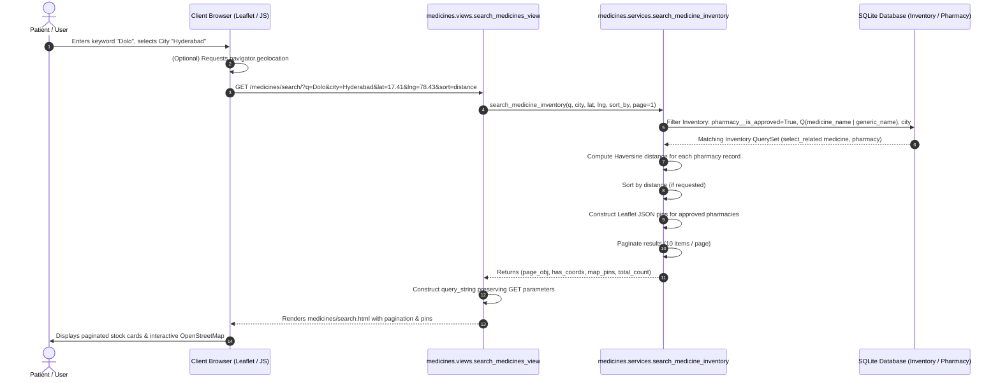

# MediFind Medicine Search & Discovery Engine Documentation

**Project:** MediFind – Location-Based Medicine Availability and Pharmacy Inventory Management Platform  
**Document:** Technical Specification & Architectural Reference  
**Phase:** Phase 2 – Search Experience & Medicine Discovery  
**Status:** Implemented & Verified  
**Date:** November 2026  

---

## 1. Architectural Overview

The MediFind Medicine Discovery Engine provides high-throughput, multi-attribute querying across verified pharmacy inventories. It connects patients seeking specific medication formulations with physical brick-and-mortar pharmacies that have reported active stock within their locality.

### 1.1 Key Technical Principles
- **Vetted Inventory Exclusivity:** Searches exclusively query records from administratively approved partner pharmacies (`pharmacy__is_approved=True`).
- **Compound Attribute Matching:** Supports brand name, chemical compound (generic name), strength, dosage form, description, city, and pincode matching in a single pipeline.
- **Client-Side Coordinates & Server-Side Haversine Distance:** Proximity sorting calculated using the Great-Circle Haversine equation on valid GPS coordinates.
- **Stateless Pagination with Preserved Criteria:** Django `Paginator` integrated with query string reconstruction, enabling frictionless pagination without losing applied filters.
- **Inventory Freshness Governance:** Visual cues alerting patients when a stock update has not been refreshed within 24 hours.

---

## 2. Pipeline Sequence Diagram



---

## 3. Query Engine & Parameter Reference

### 3.1 Input Parameters

| Parameter | Type | Validation / Constraints | Purpose |
|:---|:---|:---|:---|
| `q` | `string` | Stripped text; max 200 chars | Free-text search matching medicine brand, generic name, strength, dosage form, category, description, and pharmacy name. |
| `category` | `string` | Must match `Medicine.CATEGORY_CHOICES` | Therapeutic indication filter (e.g., *Antibiotics*, *Antidiabetic*). |
| `dosage_form` | `string` | Must match `Medicine.DOSAGE_FORM_CHOICES` | Formulation filter (e.g., *Tablet*, *Capsule*, *Syrup*, *Injection*). |
| `strength` | `string` | Stripped text (e.g., `500mg`, `10ml`) | Strength / concentration filter matching `medicine__strength__icontains`. |
| `city` | `string` | Stripped text; matches approved cities | Geographic municipality filter matching `pharmacy__city__icontains`. |
| `pincode` | `string` | Stripped postal code | Precise postal zone filter matching `pharmacy__pincode__icontains`. |
| `status` | `string` | `IN_STOCK`, `LOW_STOCK`, `OUT_OF_STOCK` | Stock availability state filter. |
| `sort` | `string` | `''` or `'distance'` | Order by default (status & recency) or distance (Haversine proximity). |
| `lat` / `lng` | `float` | Valid decimal coordinates | Latitude and Longitude for distance calculation. |
| `page` | `integer` | Positive integer; defaults to 1 | Current pagination page index. |

### 3.2 Compound ORM Query Logic

```python
# Base QuerySet: Security Guard
inventory_qs = Inventory.objects.filter(
    pharmacy__is_approved=True
).select_related('medicine', 'pharmacy')

# Free-Text Keyword Matching
if query:
    inventory_qs = inventory_qs.filter(
        Q(medicine__medicine_name__icontains=query) |
        Q(medicine__generic_name__icontains=query) |
        Q(medicine__strength__icontains=query) |
        Q(medicine__dosage_form__icontains=query) |
        Q(medicine__category__icontains=query) |
        Q(medicine__description__icontains=query) |
        Q(pharmacy__pharmacy_name__icontains=query)
    )

# Faceted Filters
if category:
    inventory_qs = inventory_qs.filter(medicine__category=category)
if dosage_form:
    inventory_qs = inventory_qs.filter(medicine__dosage_form=dosage_form)
if strength:
    inventory_qs = inventory_qs.filter(medicine__strength__icontains=strength)
if city:
    inventory_qs = inventory_qs.filter(pharmacy__city__icontains=city)
if pincode:
    inventory_qs = inventory_qs.filter(pharmacy__pincode__icontains=pincode)
if stock_status:
    inventory_qs = inventory_qs.filter(availability_status=stock_status)
```

---

## 4. Geolocation & Proximity Computation

When client coordinates (`lat`, `lng`) are supplied, proximity distances are calculated using the Haversine trigonometric formula:

$$d = 2r \arcsin\left(\sqrt{\sin^2\left(\frac{\Delta \phi}{2}\right) + \cos(\phi_1)\cos(\phi_2)\sin^2\left(\frac{\Delta \lambda}{2}\right)}\right)$$

Where:
- $r = 6371.0\text{ km}$ (Mean Earth radius)
- $\phi_1, \phi_2$ are latitudes in radians
- $\Delta \phi = \phi_2 - \phi_1$
- $\Delta \lambda = \lambda_2 - \lambda_1$

### 4.1 Proximity Sorting
When `sort=distance` is requested:
```python
inventory_results.sort(
    key=lambda x: (x.distance_km is None, x.distance_km if x.distance_km is not None else float('inf'))
)
```
Pharmacies with valid coordinates are ordered from closest to furthest. Pharmacies missing coordinates are placed safely at the end of the list.

### 4.2 Interactive Map Integration
Pharmacy GPS coordinates are serialized to JSON and loaded into OpenStreetMap via Leaflet.js:
- Pins display pharmacy name, street address, reported stock status, and direct telephone links.
- "Pin on Map" action buttons on individual stock cards automatically center and open the corresponding map pin.

---

## 5. Pagination Engine & Query State Preservation

### 5.1 Pagination Implementation
Results are split into pages of 10 items using `django.core.paginator.Paginator`:
- `PageNotAnInteger` exceptions default safely to page 1.
- `EmptyPage` exceptions default safely to the final available page.

### 5.2 Query String Preservation
To prevent users from losing their search keyword, filters, and sort options when clicking to page 2 or page 3, `search_medicines_view` generates a preserved query string:
```python
query_dict = request.GET.copy()
query_dict.pop('page', None)
query_string = query_dict.urlencode()
```
Pagination links in `templates/medicines/search.html` format links as:
```html
<a class="page-link" href="?{{ query_string }}&page={{ page_obj.next_page_number }}">Next</a>
```
This guarantees that filtering by `?q=Dolo&city=Hyderabad` maintains both parameters when transitioning to `?q=Dolo&city=Hyderabad&page=2`.

---

## 6. Inventory Data Freshness Protocol

In a healthcare inventory platform, presenting out-of-date inventory as guaranteed stock creates significant patient risk.

### 6.1 Freshness Determination
The `Inventory` model includes an `@property` checking whether the lot update exceeds 24 hours:
```python
@property
def is_stale(self):
    if not self.updated_at:
        return False
    return (timezone.now() - self.updated_at) > datetime.timedelta(hours=24)
```

### 6.2 Visual Presentation Rules

| Freshness Status | Condition | Badge Display | Recommendation to Patient |
|:---|:---|:---|:---|
| **Fresh Update** | `is_stale == False` | `<span class="badge bg-success-subtle text-success-emphasis">` **Fresh update (X mins/hours ago)** | High confidence. Proceed with request or direct pickup. |
| **Stale Record** | `is_stale == True` | `<span class="badge bg-warning-subtle text-warning-emphasis">` **Reported >24h ago • Inquire to confirm** | Medium confidence. Patient advised to call or submit request prior to traveling. |

---

## 7. Medicine Detail Monograph & Clinical Disclaimer

The Medicine Detail page (`/medicines/<id>/`) is architected with a strict separation between pharmacological drug specifications and retail pharmacy stock.

### 7.1 Monograph Specifications (Left Column)
- Full Brand Name and Generic Chemical Active Compound.
- Dosage Form and Strength Concentration.
- Therapeutic Category.
- Therapeutic Indications & Clinical Instructions (from database).
- **Mandatory Medical Disclaimer:**
  > **Medical Advice & Prescriptions Disclaimer**  
  > MediFind provides reported pharmacy inventory listings for informational purposes only. Do not self-medicate or alter dosage without certified physician consultation. Prescription medications require a valid doctor's prescription upon collection.

### 7.2 Approved Pharmacy Inventory (Right Column)
- Displays all approved partner pharmacies reporting stock for the formulation.
- Each store listing contains store address, phone, stock status badge, and freshness timestamp.
- Direct action triggers: "Request Availability" (submits an inquiry) and "Call Store" (`tel:` link).
- Leaflet map displaying pins of all pharmacies currently stocking this drug.
