# Password Management & Security Architecture Report

## 1. Executive Summary

This report documents the password management architecture, security protocols, cryptographic implementations, and user authentication lifecycle implemented for **MediFind**. MediFind utilizes industry-standard, cryptographically robust Django authentication mechanisms adhering to OWASP Application Security Verification Standard (ASVS) Level 2 guidelines.

The implementation strictly avoids rolling custom cryptographic or credential management routines, relying on Django's battle-tested built-in authentication views and token generators, while integrating customized templates, session handling, open-redirect prevention, and credential sanitization.

---

## 2. Password Storage & Cryptographic Standards

### 2.1 Password Hashing Algorithm
MediFind enforces Django's default cryptographic hashing algorithm: **PBKDF2 (Password-Based Key Derivation Function 2) with SHA-256 hash**.
- **Algorithm**: `django.contrib.auth.hashers.PBKDF2PasswordHasher`
- **Hash Format**: `pbkdf2_sha256$<iterations>$<salt>$<hash>`
- **Iterations**: 720,000 rounds (Django 5.2 default, tuned for resistance against ASIC and GPU-accelerated brute-force attacks).
- **Salt Generation**: Cryptographically secure pseudo-random salt generated per password using `os.urandom()`, preventing rainbow table precomputation.

### 2.2 Password Validation Policies
Configured in `config/settings.py` under `AUTH_PASSWORD_VALIDATORS`:
1. `UserAttributeSimilarityValidator`: Prevents passwords similar to username, first name, last name, or email.
2. `MinimumLengthValidator`: Enforces a minimum length of 8 characters.
3. `CommonPasswordValidator`: Rejects top 20,000 commonly compromised/leaked passwords.
4. `NumericPasswordValidator`: Prevents entirely numeric passwords.

---

## 3. Password Lifecycle Workflows

```mermaid
flowchart TD
    subgraph Authenticated Flow: Password Change
        A[User navigates to Profile / Settings] --> B[Click 'Change Password']
        B --> C[PasswordChangeView: Enter Old & New Password]
        C --> D{Validate Old Password & Policy}
        D -- Invalid --> C
        D -- Valid --> E[Hash & Save New Password]
        E --> F[Update Session Hash / Invalidate other sessions]
        F --> G[PasswordChangeDoneView: Confirmation Screen]
    end

    subgraph Unauthenticated Flow: Self-Service Password Reset
        H[Login Page] --> I[Click 'Forgot Password?']
        I --> J[PasswordResetView: Enter Registered Email]
        J --> K[Generate Secure HMAC Token & UIDB64]
        K --> L[Transmit Reset Email Console Backend in Dev]
        L --> M[PasswordResetDoneView: Generic Notice Anti-Enumeration]
        M --> N[User Clicks Link in Email]
        N --> O[PasswordResetConfirmView: Token Verification]
        O --> P[302 Redirect to set-password URL Strips Token from Referer]
        P --> Q[SetPasswordForm: Enter New Password]
        Q --> R{Validate Password Policy}
        R -- Invalid --> Q
        R -- Valid --> S[Update Password & Invalidate Old Tokens]
        S --> T[PasswordResetCompleteView: Success Screen]
    end
```

---

## 4. Architectural Implementation

### 4.1 Django Built-in Auth View Integration
MediFind wires Django's class-based authentication views in `accounts/urls.py` with custom templates matching the MediFind Design System:

| URL Pattern | View Class | Template Path | Purpose |
| :--- | :--- | :--- | :--- |
| `/accounts/password-change/` | `PasswordChangeView` | `accounts/password_change.html` | Authenticated self-service credential update. |
| `/accounts/password-change/done/` | `PasswordChangeDoneView` | `accounts/password_change_done.html` | Confirmation acknowledgment. |
| `/accounts/password-reset/` | `PasswordResetView` | `accounts/password_reset.html` | Email submission for token dispatch. |
| `/accounts/password-reset/done/` | `PasswordResetDoneView` | `accounts/password_reset_done.html` | Generic submission acknowledgment. |
| `/accounts/password-reset-confirm/<uidb64>/<token>/` | `PasswordResetConfirmView` | `accounts/password_reset_confirm.html` | Token verification & password reset form. |
| `/accounts/password-reset-complete/` | `PasswordResetCompleteView` | `accounts/password_reset_complete.html` | Final success confirmation with login CTA. |

### 4.2 Reset Token Generation & Cryptography
Password reset tokens are generated using Django's `default_token_generator` (`django.contrib.auth.tokens.PasswordResetTokenGenerator`):
- **Mechanism**: Salted HMAC-SHA256 digest over user state components:
  1. Primary Key (`user.pk`)
  2. Password Hash (`user.password`)
  3. Last Login Timestamp (`user.last_login`)
  4. Token Timestamp (days elapsed since epoch)
- **Token Invalidation Property**:
  Because the hash component incorporates `user.password`, **any successful password reset instantly and permanently invalidates all outstanding tokens generated for that user**. A token cannot be replayed or reused.
- **Expiration Window**: Enforced via Django's `PASSWORD_RESET_TIMEOUT` (default: 259,200 seconds / 3 days).

### 4.3 Protection Against Token Leakage via Referer Headers
A critical security vulnerability in many web applications is token leakage via the HTTP `Referer` header if the reset page links to external assets or CDNs.
- **MediFind Defense**: Django's `PasswordResetConfirmView` automatically handles this:
  1. The user lands on `/accounts/password-reset-confirm/<uidb64>/<token>/`.
  2. The view validates the token, stores the verified user in the internal session, and immediately issues an HTTP `302 Found` redirect to `/accounts/password-reset-confirm/<uidb64>/set-password/`.
  3. The browser address bar and subsequent HTTP headers drop the raw token parameter, ensuring zero credential/token leakage.

---

## 5. Security Posture & Vulnerability Defenses

| Threat Vector | Defense Mechanism Implemented |
| :--- | :--- |
| **User Enumeration** | `PasswordResetView` renders `PasswordResetDoneView` regardless of whether the submitted email exists in the database. No disclosure of account existence occurs. |
| **Session Fixation & Hijacking** | On password change via `PasswordChangeView`, Django invokes `update_session_auth_hash(request, user)`. This regenerates the session key, updates HMAC session validation, and terminates all other concurrent sessions for the user across different browsers/devices. |
| **Brute-Force & Timing Attacks** | Cryptographically salted PBKDF2-SHA256 with 720,000 iterations enforces deliberate CPU cost (~100ms per check), rendering offline and online dictionary brute-force computationally prohibitive. |
| **Open Redirect via Post-Auth** | Custom authentication views strictly validate redirect targets using `url_has_allowed_host_and_scheme(url, allowed_hosts={request.get_host()})`. Off-domain redirect injection is rejected. |
| **CSRF Injection** | All password change and reset forms enforce Django's cryptographically signed `` with `SameSite=Lax` cookie flags. |
| **Client-Side Shoulder Surfing** | Input fields feature an interactive, accessible JavaScript password visibility toggle (`togglePasswordVisibility`), defaulting to masked `type="password"`. |

---

## 6. Email Dispatch & Production Readiness

In development and testing environments:
- `EMAIL_BACKEND = 'django.core.mail.backends.console.EmailBackend'`
- Reset emails and tokens are routed to stdout/console, ensuring zero accidental leakage to real mailboxes during automated testing.

In production environments:
- The setting can be switched via environment variables to `django.core.mail.backends.smtp.EmailBackend` or cloud transactional services (SendGrid, Amazon SES, Mailgun) with TLS encryption.
