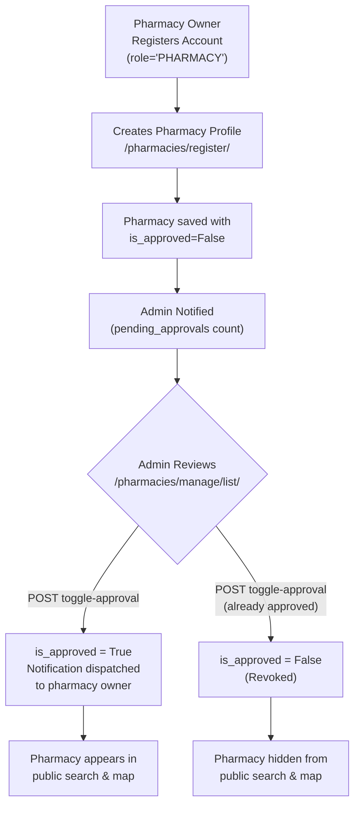

# Pharmacy Governance Documentation
**MediFind – Phase 7: Administrative Portal & Governance**

---

## 1. Overview

The MediFind pharmacy governance system controls which pharmacies are publicly discoverable and eligible to receive availability inquiries. Only admin-approved pharmacies appear in public search results and on the find-pharmacy map.

---

## 2. Pharmacy Registration Workflow



---

## 3. Approval State Model

The `Pharmacy` model uses a single boolean field `is_approved` for the approval state:

| `is_approved` | Meaning | Public Visibility |
|:---:|---------|-------------------|
| `False` | Pending / Revoked | ❌ Hidden from customers |
| `True` | Approved | ✅ Visible to customers |

> [!NOTE]
> There is no "rejected with reason" state in the current data model. Approval is a binary toggle. Pharmacy owners receive a `Notification` when their status changes.

---

## 4. Toggle Approval Service

**Location**: `pharmacies/services.py` → `toggle_pharmacy_approval(pharmacy, admin_user)`

**Behaviour**:
1. Flips `pharmacy.is_approved` (True → False, False → True)
2. Saves the pharmacy record
3. Creates a `Notification` for the pharmacy owner:
   - On approval: *"Your pharmacy has been approved. You can now manage inventory."*
   - On revocation: *"Your pharmacy approval has been revoked."*
4. Logs the action via `logger.info(...)` with admin username and pharmacy name

**Endpoint**: `POST /pharmacies/manage/<pk>/toggle-approval/`  
**Guards**: `@admin_required`, `@require_POST`, CSRF token required

---

## 5. Governance List View

**URL**: `/pharmacies/manage/list/`  
**View**: `admin_pharmacy_list_view`

### Filter Tabs

| Tab | Query Param | Behaviour |
|-----|------------|-----------|
| All | `status=all` (default) | Returns all pharmacies |
| Pending | `status=pending` | `is_approved=False` |
| Approved | `status=approved` | `is_approved=True` |

### Search

Searches across:
- `pharmacy_name` (case-insensitive contains)
- `registration_number`
- `city`
- `owner__username`
- `owner__email`

### Pagination

- 15 pharmacies per page
- `query_string` preserves active filters across page links
- `total_count` displayed on each filter tab

### Table Columns

| Column | Source |
|--------|--------|
| Pharmacy Name | `pharmacy.pharmacy_name` |
| Registration # | `pharmacy.registration_number` |
| City | `pharmacy.city` |
| Owner | `pharmacy.owner.username` |
| Status | `pharmacy.is_approved` badge |
| Registered | `pharmacy.created_at` |
| Action | Approve / Revoke button (POST form) |

---

## 6. Public Discovery Filtering

All public-facing pharmacy queries enforce `is_approved=True`:

```python
# medicines/views.py – pharmacy_detail
pharmacy = get_object_or_404(Pharmacy, pk=pk, is_approved=True)

# pharmacies/views.py – find_pharmacies_view
queryset = Pharmacy.objects.filter(is_approved=True, ...)

# inventory/views.py – public inventory
inventory = Inventory.objects.filter(pharmacy__is_approved=True, ...)
```

Unapproved pharmacies cannot receive customer inquiries — the `AvailabilityRequest` creation view validates that the target pharmacy `is_approved=True`.

---

## 7. Notification System

Notifications are stored in the `Notification` model (`requests_app/models.py`):

| Field | Value |
|-------|-------|
| `user` | Pharmacy owner |
| `message` | Approval or revocation message string |
| `is_read` | `False` on creation |
| `created_at` | Auto timestamp |

The pharmacy owner sees unread notifications in their dashboard header badge.

---

## 8. Admin Dashboard Quick Actions

The admin dashboard banner includes:
- **Verify Stores (N)** → links to `admin_pharmacy_list?status=pending` with live pending count
- **Manage Users** → links to `admin_user_list`
- **Monitor Requests** → links to `admin_request_monitor`
- **Add Medicine** → links to `add_medicine`
- **Django Admin** → opens Django built-in admin in new tab
