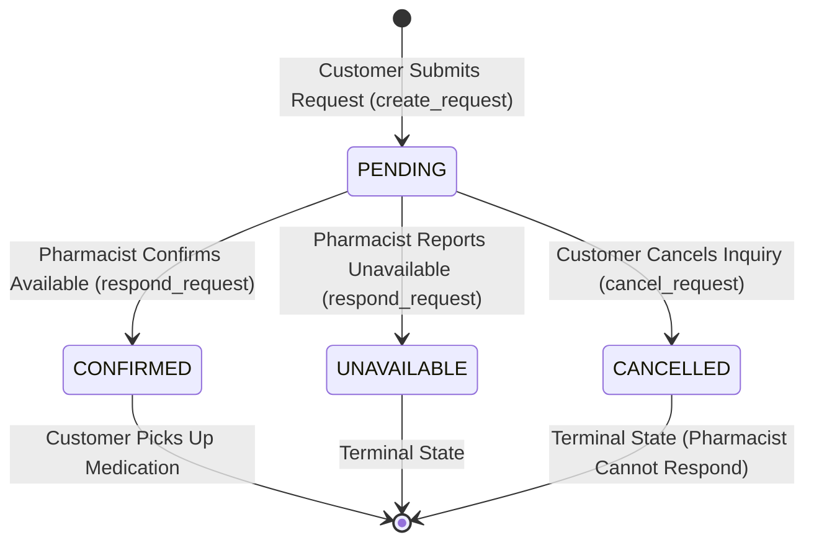

# Pharmacy Customer Request & Availability Inquiry Management

## 1. Overview & Objective

The **MediFind** Availability Request system enables customers to send direct inquiries to approved pharmacies regarding medication availability before traveling. This document details the pharmacy-side inquiry management workflows, state machines, validation rules, and multi-tenant security protections.

---

## 2. Request Lifecycle & State Machine



### 2.1 State Transition Validation
The service layer (`respond_to_availability_inquiry`) enforces strict state transition guards:
1. **Valid Status Choices**: Pharmacists can only respond with `CONFIRMED` or `UNAVAILABLE`.
2. **Terminal Guard on Cancellation**: If a customer has cancelled an inquiry (`status == 'CANCELLED'`), any pharmacist attempt to respond is intercepted and rejected with a `ValidationError`.
3. **Audit Trail**: Pharmacist notes and instructions are stored on `pharmacy_response`, and a notification is automatically dispatched to the customer.

---

## 3. Pharmacy Inbox Implementation

### 3.1 Status Count Aggregation
Rather than firing multiple individual queries, status counts are computed in a single consolidated SQL aggregation query:
```python
def get_pharmacy_inbox_counts(pharmacy: Pharmacy) -> Dict[str, int]:
    return AvailabilityRequest.objects.filter(pharmacy=pharmacy).aggregate(
        total_count=Count('id'),
        pending_count=Count('id', filter=Q(status='PENDING')),
        confirmed_count=Count('id', filter=Q(status='CONFIRMED')),
        unavailable_count=Count('id', filter=Q(status='UNAVAILABLE')),
        cancelled_count=Count('id', filter=Q(status='CANCELLED')),
    )
```

### 3.2 Filtering & Pagination
- **Filters**: Pharmacists can toggle tabs for `Pending`, `Confirmed`, `Unavailable`, `Cancelled`, and `All History`.
- **Pagination**: Results are paginated at 10 requests per page, preserving query parameters across navigation.
- **Cancelled Item UX**: Cancelled requests display a muted "Cancelled by Customer" badge, disabling the response button to prevent wasted effort.

---

## 4. Multi-Tenant Protection

- **Pharmacy Isolation**: `AvailabilityRequest.objects.filter(pharmacy=pharmacy)` guarantees that a pharmacy can only view inquiries addressed directly to its store.
- **Cross-Store Response Guard**: `get_object_or_404(AvailabilityRequest, pk=pk, pharmacy=pharmacy)` guarantees that Pharmacist A cannot respond to an inquiry belonging to Pharmacist B. Any unauthorized attempt returns an HTTP 404 response.
