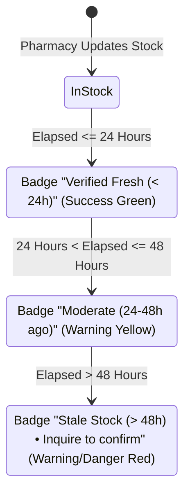

# Pharmacy Search & Discovery Documentation

## 1. Overview

MediFind provides two interconnected discovery interfaces designed to solve the critical problem of finding essential medicines and verified nearby pharmacies without unnecessary travel:
1. **Nearby Pharmacy Directory** (`/pharmacies/`): Focuses on discovering licensed pharmacies near the user's location, filtering by proximity radius (5–50 km), city, or pincode, with map pins and contact info.
2. **Medicine Inventory Search** (`/medicines/search/`): Focuses on discovering specific medications across approved pharmacies, combining therapeutic filters (category, dosage form, strength) with geospatial proximity and clinical inventory freshness indicators.

---

## 2. Request Parameters & Query Filter Contract

Both endpoints process standard HTTP GET parameters, ensuring URLs can be shared, bookmarked, and refreshed without losing state:

| Parameter | Type | Default | Description | Example Values |
| :--- | :--- | :--- | :--- | :--- |
| `q` | `string` | `""` | Keyword search against pharmacy names, addresses, or medicine names/generics. | `Apollo`, `Dolo 650`, `Amoxicillin` |
| `city` | `string` | `""` | Filters results matching pharmacy city (case-insensitive substring match). | `Hyderabad`, `Secunderabad` |
| `pincode` | `string` | `""` | Filters results matching pharmacy postal code. | `500033`, `500081` |
| `radius` | `string/number` | `""` | Proximity radius in kilometers. Applied only when valid `lat`/`lng` coordinates exist. | `5`, `10`, `25`, `50` |
| `lat` | `float` | `""` | Customer's latitude in decimal degrees. Validated against $[-90, 90]$. | `17.435000` |
| `lng` | `float` | `""` | Customer's longitude in decimal degrees. Validated against $[-180, 180]$. | `78.410000` |
| `sort` | `string` | `"distance"` | Ordering strategy: `distance` (nearest first), `name` (A-Z), or `newest`. | `distance`, `name` |
| `page` | `integer` | `1` | Pagination target page. | `1`, `2` |

---

## 3. Inventory Integration & Freshness Classification

Stock records from approved pharmacies are coupled with timestamps and classified into three distinct clinical freshness tiers:



### 3.1 Freshness Business Rules
- **Fresh Tier ($\le 24\text{ hours}$)**: Recently verified. Displayed with a green checkmark badge.
- **Moderate Tier ($24 - 48\text{ hours}$)**: Older update. Advised to verify before visiting.
- **Stale Tier ($> 48\text{ hours}$)**: Unverified inventory. Displayed with explicit warning badge *"Reported >24h ago • Inquire to confirm"* and *"Stale (>48h)"*.
- **Out of Stock**: Displayed as *"Reported Out of Stock"*, allowing customers to submit availability inquiries via the platform.

---

## 4. Map & Visual Data Contract

Map metadata is serialized via Django's `json_script` filter into safe DOM elements (`#pharmacy-pins-data`, `#user-coords-data`), eliminating inline script injection risks:

### 4.1 Pharmacy Pin Schema
```json
{
  "id": 1,
  "name": "Jubilee Care Chemist",
  "address": "Road No 36, Jubilee Hills, Hyderabad - 500033",
  "phone": "040-23551122",
  "lat": 17.425000,
  "lng": 78.410000,
  "distance_km": 1.11,
  "is_approved": true,
  "medicine": "Paracetamol 650mg",
  "status": "In Stock",
  "freshness_tier": "FRESH"
}
```

### 4.2 Customer Pin Schema
```json
{
  "lat": 17.435000,
  "lng": 78.410000
}
```

---

## 5. UI/UX States & Error Handling

1. **Card View vs. Map View**: Seamless toggle button without page reloads. Leaflet map recalculates its container dimensions upon display using `map.invalidateSize()`.
2. **Empty Search States**: When queries or distance filters yield zero matches, a dedicated empty-state component displays search tips (e.g., widening the radius, trying generic salt names, clearing city restrictions).
3. **Pagination Query String Preservation**: All active filter parameters (`q`, `city`, `pincode`, `radius`, `lat`, `lng`, `sort`) are serialized into pagination links (`?q=Dolo&city=Hyderabad&radius=10&page=2`), preventing filter drop-off during browsing.
