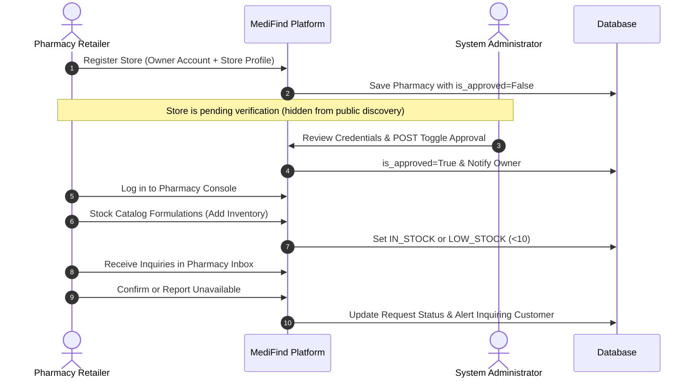

# Pharmacy Workflow Test Report
**MediFind – Phase 9: End-to-End Pharmacy Partner Lifecycle Validation**

---

## 1. Overview

This report documents the verification of the complete pharmacy operations workflow, including onboarding, administrative vetting, facility dashboard management, inventory tracking, low-stock threshold triggers, and customer inquiry fulfillment.

---

## 2. Pharmacy Workflow Lifecycle

---

## 3. Step-by-Step Test Execution & Findings

| Step | Action | Method & Endpoint | Expected Behaviour | Actual Result |
|:----:|--------|-------------------|--------------------|:-------------:|
| **1** | Registration | `POST /accounts/register/pharmacy/` | Atomically creates `User(role='PHARMACY')` and `Pharmacy(is_approved=False)` | PASS |
| **2** | Pending Privacy Check | `GET /pharmacies/<id>/` | Public access blocked (redirects to search with warning); only owner/admin can inspect | PASS |
| **3** | Admin Approval | `POST /pharmacies/manage/<id>/toggle-approval/` | Sets `is_approved=True`; dispatches audit notification to store owner | PASS |
| **4** | Console Dashboard | `GET /dashboard/pharmacy/` | Real-time stock distribution chart, low-stock alerts, pending inquiry badges | PASS |
| **5** | Stock Management | `GET /inventory/` | Paginated catalog stock list, status badges, search and sort controls | PASS |
| **6** | Add Inventory | `POST /inventory/add/` | Stocks medicine from master catalog; auto-assigns status based on units | PASS |
| **7** | Duplicate Stock Guard | `POST /inventory/add/` | Re-adding existing medicine gracefully updates quantity instead of throwing integrity error | PASS |
| **8** | Low-Stock Transition | `POST /inventory/<id>/edit/` | Setting quantity < 10 automatically transitions status to `LOW_STOCK` | PASS |
| **9** | Out-of-Stock Transition | `POST /inventory/<id>/edit/` | Setting quantity = 0 automatically transitions status to `OUT_OF_STOCK` | PASS |
| **10** | Request Response | `POST /requests/<id>/respond/` | Records status (`CONFIRMED` or `UNAVAILABLE`) and notes; alerts customer | PASS |
| **11** | Multi-Tenant Isolation | `GET/POST /inventory/<other_id>/edit/` | Cross-tenant access attempts return HTTP 404; store data strictly isolated | PASS |

---

## 4. Multi-Tenant Isolation Security

Every inventory and request modification endpoint enforces multi-tenant scoping:
- `get_object_or_404(Inventory, pk=pk, pharmacy=pharmacy)`
- `get_object_or_404(AvailabilityRequest, pk=pk, pharmacy=pharmacy)`

Attempting to view, edit, or delete inventory belonging to another pharmacy returns **HTTP 404 Not Found**, preventing enumeration and unauthorized tampering.
