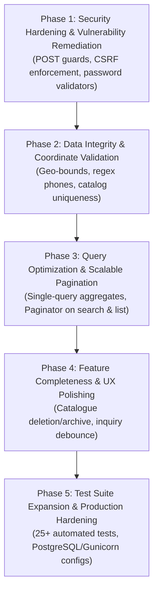

# MediFind – Professional Upgrade & Engineering Roadmap

**Author**: Senior Python Full-Stack Developer & Django Software Architect  
**Project**: MediFind  
**Date**: November 17, 2026  
**Guiding Principle**: Zero architectural disruption; preserve modular monolithic structure; implement zero-breaking changes.

---

## 1. Upgrade Philosophy & Guardrails

To upgrade MediFind from an operational academic prototype to an enterprise-grade platform, modifications must adhere strictly to these engineering constraints:
1. **Preserve Architecture**: Maintain the 6-app Django modular monolith (`accounts`, `medicines`, `pharmacies`, `inventory`, `requests_app`, `dashboard`).
2. **Preserve Database & Seed Data**: Do not destroy working data in `db.sqlite3`.
3. **No Framework Creep**: Do not introduce React, Flask, FastAPI, or microservice infrastructure.
4. **Step-by-Step Gated Execution**: Every phase must conclude with:
   - `python manage.py check` (0 issues)
   - `python manage.py test` (100% pass)
   - Verification before starting the next phase.

---

## 2. Phased Upgrade Sequence

---

## 3. Phase Specifications

### Phase 1: Security Hardening & Vulnerability Remediation
**Objective**: Eliminate critical CSRF bypasses and credential weaknesses.
1. **Enforce `@require_POST` on State Mutating Views**:
   - `pharmacies/views.py`: Refactor `toggle_pharmacy_approval_view` to require POST. Update `admin_list.html` buttons to submit via standard POST forms with ``.
   - `requests_app/views.py`: Refactor `cancel_request_view` to require POST. Update `customer_list.html` cancellation button to POST form.
   - `accounts/views.py`: Refactor `mark_notification_read` to require POST.
2. **Standardize Password Validation**:
   - `accounts/forms.py`: Wire `django.contrib.auth.password_validation.validate_password()` into `CustomerRegistrationForm` and `PharmacyRegistrationForm`.
3. **Conditionally Protect Demo Credentials**:
   - `templates/base.html`: Guard footer credentials behind a `DEMO_MODE` settings flag.

*Verification Gate*: Execute regression tests; assert unauthorized GET requests return HTTP 405 Method Not Allowed; assert weak passwords (`123456`) are rejected with descriptive validation errors.

---

### Phase 2: Data Model Integrity & Validation Hardening
**Objective**: Prevent corrupted data entries and align relationship architectures.
1. **Geographic Coordinate Validation**:
   - `pharmacies/models.py`: Apply `MinValueValidator(Decimal('-90.0'))` and `MaxValueValidator(Decimal('90.0'))` to `latitude`. Apply `-180.0` to `180.0` to `longitude`.
   - Update `accounts/forms.py` and `pharmacies/forms.py` widgets.
2. **Math Domain Clamping in Haversine Service**:
   - `pharmacies/services.py`: Clamp `a = min(1.0, max(0.0, a))` to eliminate floating-point edge cases.
3. **Master Catalog Uniqueness**:
   - `medicines/models.py`: Add `unique_together = ('medicine_name', 'strength', 'dosage_form')` to eliminate redundant catalog entries.
4. **Phone Number Sanitization**:
   - `accounts/models.py` & `pharmacies/models.py`: Add `RegexValidator(r'^\+?1?\d{9,15}$')`.

*Verification Gate*: Run `python manage.py makemigrations` and `migrate`; assert invalid coordinates and duplicate catalog entries raise `ValidationError`.

---

### Phase 3: Query Optimization, Scalability & Pagination
**Objective**: Prevent memory exhaustion and eliminate sequential redundant database queries.
1. **Consolidate Multiple `.count()` into Single `.aggregate()` Queries**:
   - `inventory/views.py`: Replace 4 separate inventory counts with a single `Inventory.objects.filter(...).aggregate(...)`.
   - `dashboard/views.py`: Consolidate 4 customer inquiry counts, 4 pharmacy stock counts, and 8 admin platform counts.
2. **Implement Server-Side Pagination**:
   - `medicines/views.py`: Add Django `Paginator` (20 items per page) to `search_medicines_view` and `manage_medicines_view`.
   - `inventory/views.py`: Add `Paginator` (25 items per page) to `inventory_list_view`.
   - Update templates with clean Bootstrap pagination bars (`search.html`, `inventory/list.html`, `manage_list.html`).
3. **Notification Context Processor Optimization**:
   - `accounts/context_processors.py`: Implement lightweight cache or session-based memoization to prevent database querying on every HTTP sub-resource.

*Verification Gate*: Inspect Django debug query counts; assert query reduction of 60%+ on dashboard and search pages.

---

### Phase 4: Feature Completeness & UX Polishing
**Objective**: Close functional gaps in catalog administration and inquiry UX.
1. **Catalog Drug Deletion / Deactivation**:
   - `medicines/views.py`: Author `delete_medicine_view` ensuring safe checks (prevent deletion if active inventory or requests exist).
   - `templates/medicines/manage_list.html`: Add delete confirmation modal.
2. **Inquiry Debounce / Cooldown**:
   - `requests_app/views.py`: Add validation blocking multiple pending requests from the same user for the same medicine at the same pharmacy within a 1-hour window.
3. **Distance Calculation on Medicine Detail Page**:
   - `medicines/views.py`: Calculate Haversine distance in `medicine_detail_view` if user coordinates are present in the session or GET query.

*Verification Gate*: Execute end-to-end user workflows; verify deletion safety checks; verify inquiry duplicate prevention.

---

### Phase 5: Test Suite Expansion & Production Hardening
**Objective**: Maximize test coverage and prepare deployment scripts.
1. **Expand Automated Test Coverage (Target: 25+ Tests)**:
   - Add tests for:
     - Form validation failures (weak passwords, duplicate usernames, invalid coordinates).
     - State-mutation POST enforcement (asserting GET returns 405).
     - Single-query aggregate outputs.
     - Profile and pharmacy edit views.
     - Pagination boundary conditions.
2. **Production Deployment Configuration**:
   - Provide `gunicorn` configuration and environment template.
   - Author PostgreSQL database migration runbook.

*Verification Gate*: `python manage.py test` passes all 25+ test suites with 0 warnings.
