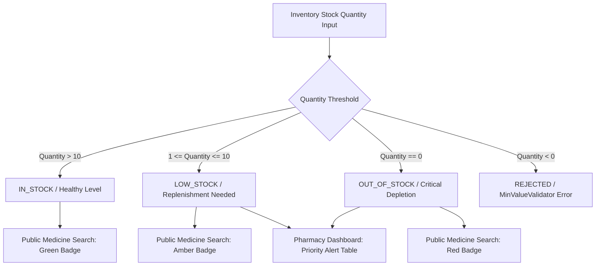

# Real-Time Stock Monitoring & Freshness Report

## 1. Executive Summary

This report outlines the real-time stock level monitoring mechanisms, clinical freshness classification algorithms, and stockout prevention alerts engineered for the **MediFind** healthcare platform.

Maintaining high data fidelity is vital in emergency and prescription drug procurement. Outdated stock records can lead patients to arrive at pharmacies only to find needed medications depleted. MediFind enforces automated status classification, low-stock threshold alerting, and time-based freshness indicators to ensure reliable patient discovery.

---

## 2. Stock Health & Classification Hierarchy



---

## 3. Clinical Freshness Tiers

Stock updates are monitored against a three-tier clinical freshness model evaluated dynamically at access time:

| Freshness Tier | Elapsed Since Last Update | Clinical Status | UI Indicator | Action Required |
| :--- | :--- | :--- | :--- | :--- |
| **FRESH** | $\le 24$ hours | High Confidence | Verified Fresh badge (Green) | Ready for patient discovery |
| **MODERATE** | $24$ to $48$ hours | Moderate Confidence | Moderate badge (Amber) | Pharmacy encouraged to verify counts |
| **STALE** | $> 48$ hours | Low Confidence | Stale Stock badge (Red/Outline) | Patient prompted to send inquiry |

### 3.1 Freshness Implementation
```python
@property
def freshness_tier(self):
    if not self.updated_at:
        return 'STALE'
    elapsed = timezone.now() - self.updated_at
    if elapsed <= datetime.timedelta(hours=24):
        return 'FRESH'
    elif elapsed <= datetime.timedelta(hours=48):
        return 'MODERATE'
    else:
        return 'STALE'
```

---

## 4. Low-Stock & Depletion Alerting Engine

The pharmacy dashboard aggregates formulations requiring replenishment into a dedicated alert feed:
- Queries records where `availability_status__in=['LOW_STOCK', 'OUT_OF_STOCK']` scoped to the current pharmacy.
- Ordered by `quantity ASC`, prioritizing depleted formulations (`0 units`) followed by low-reserve items (`1-10 units`).
- Direct action button allows single-click navigation to update lot quantities upon receiving vendor shipments.
