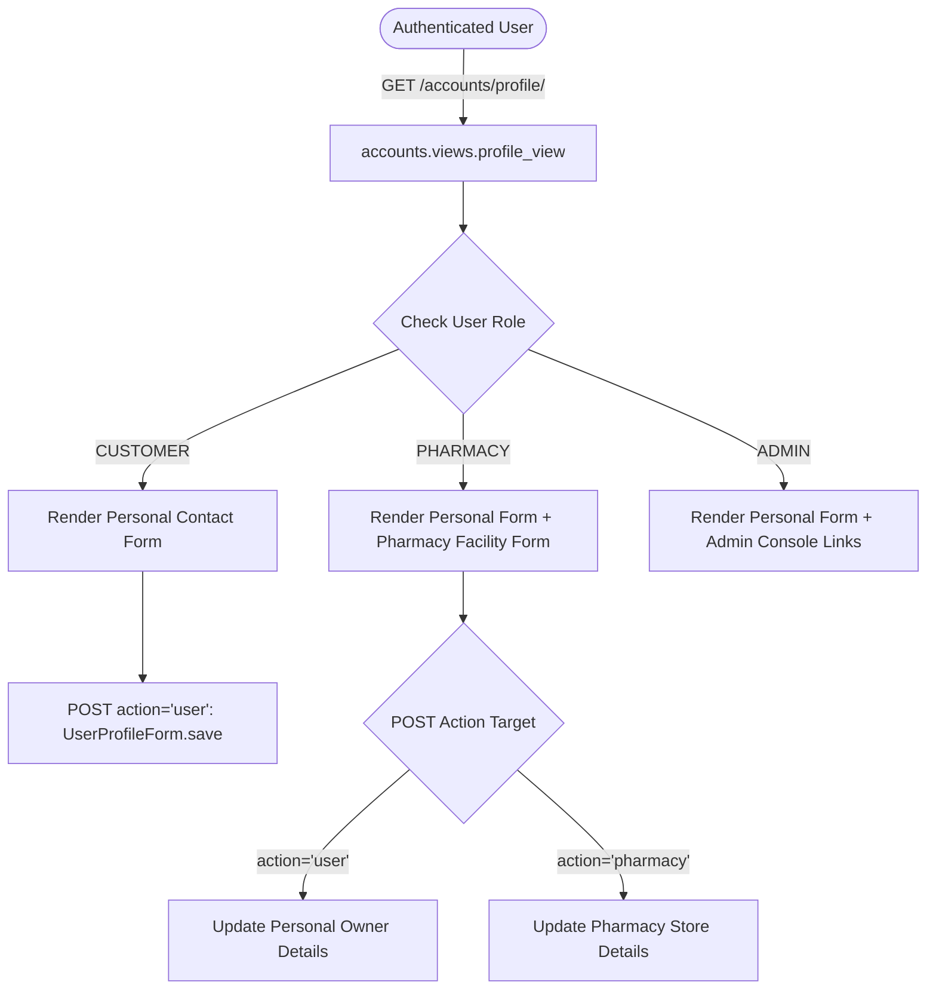

# MediFind User Profile & Facility Management Documentation

**Project:** MediFind – Location-Based Medicine Availability and Pharmacy Inventory Management Platform  
**Document:** Technical Specification & Security Reference  
**Phase:** Phase 3 – Authentication & User Profile Enhancement  
**Status:** Implemented & Verified  
**Date:** November 2026  

---

## 1. Architectural Overview

The MediFind Profile Management subsystem (`/accounts/profile/`) provides an adaptive, role-aware interface that serves all three platform personas:
1. **Patients / Customers:** Personal contact and identity management.
2. **Pharmacy Owners:** Combined personal account details and physical pharmacy store profile management.
3. **Administrators:** System management profile with administrative indicators.

The implementation strictly enforces backend object ownership, preventing unauthorized cross-tenant modifications or privilege escalation.

---

## 2. Profile Workflows by Persona



---

## 3. Customer Profile Management

### 3.1 Editable Fields
Patients can manage their primary demographic and communication details:
- **First Name:** Given name.
- **Last Name:** Family surname.
- **Email Address:** Electronic mail address for automated notification delivery. Enforces case-insensitive uniqueness against other accounts.
- **Phone Number:** Mobile contact number for pharmacy inquiries.

### 3.2 Security Perimeter & Field Protection
- **Role Immutability:** The `role`, `is_staff`, `is_superuser`, and `date_joined` fields are strictly excluded from `UserProfileForm.Meta.fields`.
- **Tampering Resistance:** Even if an attacker manually injects `role=ADMIN` or `is_staff=True` into the POST payload, Django's model form discards unexpected parameters, keeping the user's role and privileges intact.
- **Session Scoping:** Updates are committed exclusively to `request.user`.

---

## 4. Pharmacy Owner Profile Management

For users with the `PHARMACY` role, the profile page expands into a dual-management workspace.

### 4.1 Read-Only Security Guardrails
Critical regulatory and compliance fields cannot be edited by the pharmacy owner:
1. **Drug License / Registration Number (`registration_number`):** Displayed as an immutable badge. Preventing retailers from altering their license number after initial vetting guarantees traceability.
2. **Administrative Approval Status (`is_approved`):** Displayed as a real-time status pill:
   - `<span class="badge bg-success-subtle text-success-emphasis">Approved & Publicly Visible</span>`
   - `<span class="badge bg-warning-subtle text-warning-emphasis">Pending Administrative Review</span>`
   Pharmacy owners cannot toggle their own verification status.

### 4.2 Editable Store Facility Details (`PharmacyProfileForm`)
Pharmacy owners can update operational store metadata:
- **Pharmacy Trade Name:** Public business name displayed on medicine stock listings.
- **Store Phone Number:** Public telephone number patients call to verify urgent inventory.
- **Store Address:** Street address, building number, and landmark.
- **City, State & Pincode:** Municipal and postal zone attributes utilized by location search filters.
- **Latitude & Longitude:** GPS decimal coordinates utilized by Haversine proximity calculations and OpenStreetMap Leaflet pins.

### 4.3 Multi-Tenant Isolation
The facility instance is resolved strictly via the authenticated user's session:
```python
pharmacy = get_pharmacy_for_user(request.user)
```
No pharmacy primary key is accepted in the URL or form body. Consequently, a malicious pharmacy owner cannot forge an ID to update another retailer's facility information.

---

## 5. UI/UX Design System Compliance

The profile view (`templates/accounts/profile.html`) adheres to the MediFind Healthcare Design System:
- **Account Overview Card:** Displays role badge, username, and account registration date.
- **Direct Password Change Trigger:** Features a prominent **Change Password** button leading to `/accounts/password-change/`.
- **Visual Separation:** Clear subheadings (`Personal Contact Information` vs `Pharmacy Store Profile`) with dedicated save buttons prevent accidental overwrites.
- **Responsive Layout:** Form grids collapse from 2 columns on desktop to a single stacked column on mobile devices.
